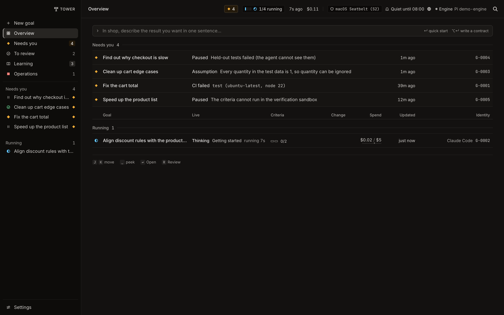
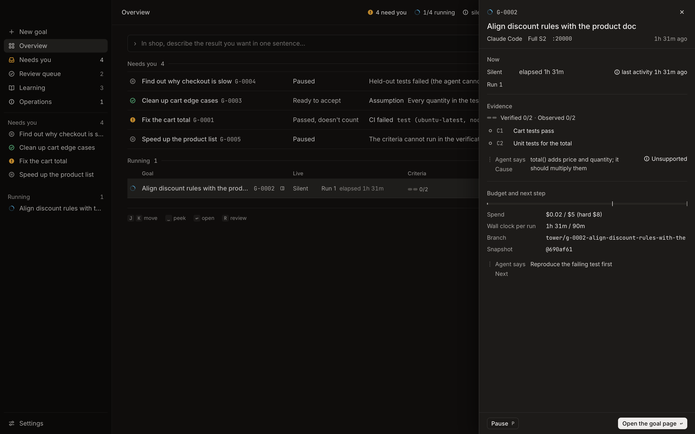
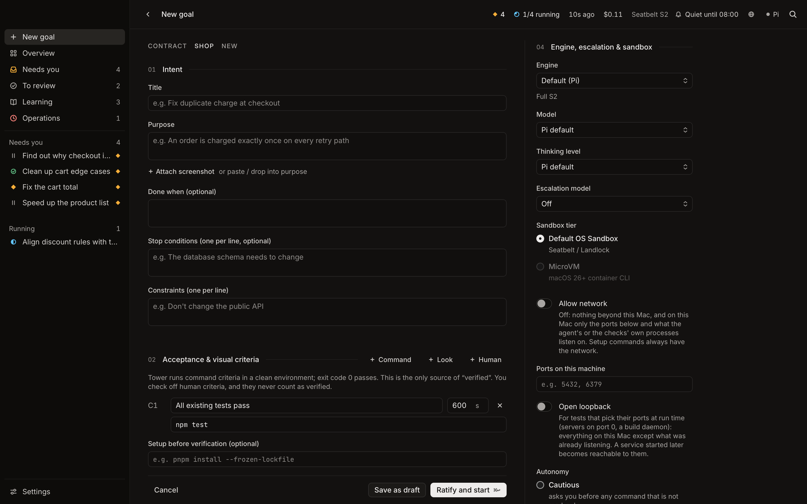
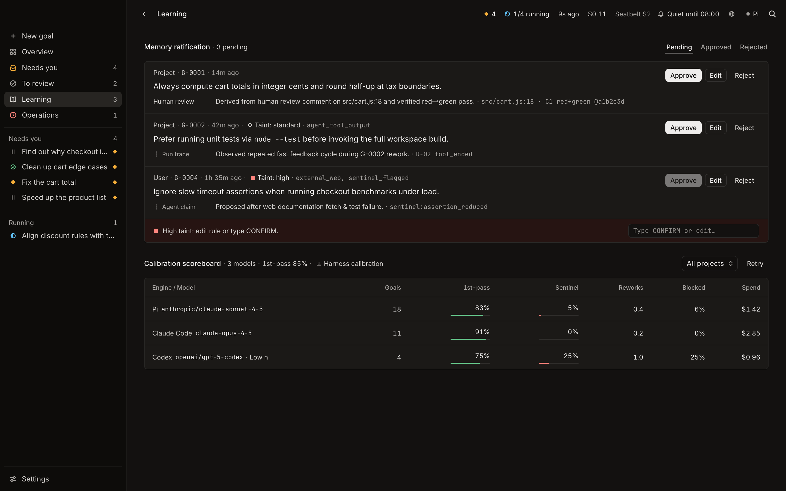
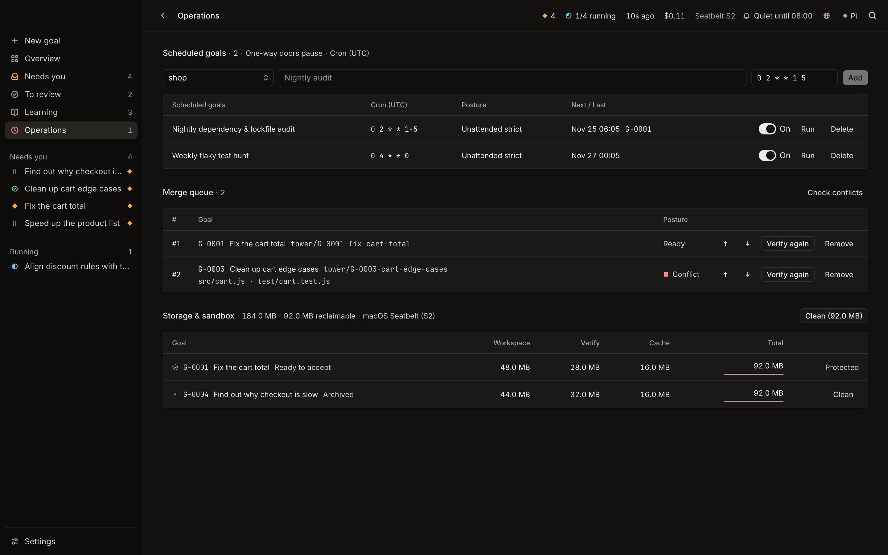

# Tower

English · [简体中文](README.zh-CN.md)

Tower is a macOS desktop app for supervising coding agents. You give an agent a goal with acceptance criteria. The agent works in a sandbox. When it says it is done, Tower checks the work itself in a clean checkout. Then you review the change and accept it.



Chat-style agent tools show you a transcript. With several agents running for hours, a transcript tells you little: "all tests pass" in a message looks the same as a real test run. Tower is built around different questions. For each goal it shows what the agent was asked to do, what it is doing now, what has actually been proven, and what changed.

> **Status:** there is no signed public release yet. Build it from source (below). macOS 13 or later is the supported platform, and CI runs on macOS only.

## How a goal works

A goal is a **contract**. It holds:

- the intent;
- the acceptance criteria: commands to run, screenshots to compare (`look`), and checks only you can make;
- the files the agent may touch;
- a spend and time budget;
- how much the agent may do without asking.

A goal moves through three states:

1. **Claimed:** the agent says it is done.
2. **Verified:** Tower ran the criteria itself and they passed.
3. **Accepted:** you reviewed the change and sealed it.

The screen keeps four kinds of statement apart, by shape and not by color alone:

| Kind | What it is | Can it be green? |
|---|---|---|
| **Fact** | Something Tower measured, such as a verifier result | Only a fresh, untampered verifier pass |
| **Observation** | Output seen inside the agent's own sandbox | No |
| **Claim** | Anything the agent wrote: logs, summaries, "blocked" reports | No |
| **Human** | Your contracts, approvals and acceptances | — |

## Verification

When the agent claims a goal is done, Tower pins a snapshot of the work. It checks that snapshot in a new clean checkout, with no credentials and a throwaway package cache:

1. **Base run.** The criteria run on the base commit first. A criterion that already passes there cannot prove the goal was done.
2. **Visible criteria.** They run on the snapshot, under the goal's sandbox. Setup is offline unless the contract allows network.
3. **Held-out tests.** These never enter the agent's workspace or prompts. They run after the visible criteria pass. Tower checks that each test file actually ran.
4. **Source-only re-run.** Tower reverts every change that is not source code (tests, fixtures, config, scripts) and runs the criteria again. Rust inline tests are restored with a Tree-sitter parse.
5. **Tamper checks.** Tower adds a test that must fail and changes expected values. If the criteria still pass, the pass is not counted. Assertion libraries are guarded before project code loads, and results are written append-only.
6. **Perturbation and flaky checks.** Tower changes numeric inputs to catch some hard-coded answers. A newly failing criterion runs once more, so a flaky test is shown as flaky.

These checks raise the cost of cheating but do not rule it out. The real-model anti-cheat run does not pass yet, and [`docs/17-implementation.md`](docs/17-implementation.md) §17.7 lists the kinds of cheat it still misses.

For `look` criteria, Tower takes before and after screenshots in a headless browser, at desktop and phone sizes, and records the page's console errors next to them.

The details are in [`docs/07-verification-and-honesty.md`](docs/07-verification-and-honesty.md).

## Sandbox

Each goal gets its own deny-by-default sandbox. On macOS that is Seatbelt:

- **Reads:** system paths, toolchains and the goal's workspace only. Your home folder, other projects and credential stores (`~/.ssh`, `~/.aws`, `~/.config/gh`) are closed, and `*_API_KEY` variables are not passed in.
- **Writes:** only the goal's workspace, its temp folder and a copy-on-write package cache. Your own caches can't be changed.
- **Agent instruction files:** writes to `AGENTS*.md`, `CLAUDE*.md`, `.pi/` and `.agents/` are refused at any depth, and so are hard links.
- **Network:** off unless the contract turns it on. Each goal has its own block of 10 loopback ports. Other Unix sockets, such as `docker.sock` and ssh-agent, stay closed.
- **Cleanup:** when a run ends, Tower stops every process the kernel reports inside that goal's sandbox, and none of yours.

There is also a Linux backend (`bubblewrap`, Landlock and cgroups v2) and an optional MicroVM tier using Apple Containerization on macOS 26+ with Apple Silicon. CI runs on macOS only and tests neither of them for real.

[`SECURITY.md`](SECURITY.md) has the threat model and the 118 security tests that CI runs on every push. It also lists the known limits.

## Engines

| Engine | Connection | Trust tier | Tools the agent gets |
|---|---|---|---|
| [Pi](https://github.com/earendil-works/pi) (default) | Native JSONL RPC | Full | 7 fixed tools: `read`, `bash`, `edit`, `write`, `ask_user`, `log`, `submit`. MCP and repo-local Pi resources are off. |
| Claude Code | ACP | Full | Only Tower's sandboxed MCP tools. Built-in tools, hooks and other MCP servers are removed. |
| Codex CLI, Gemini CLI, OpenCode | ACP | Restricted | Any permission request for a tool outside Tower's is refused and logged. |
| Other ACP adapters | ACP | Experimental | Labeled as experimental everywhere they appear. |

The agent's `bash` commands go through a POSIX shell parser before they run. Commands that can't be undone, and hidden writes in cautious mode, stop for your answer.

An agent that can't finish can say so with `submit(outcome: "blocked")`. That pauses the goal and shows the agent's reason as a Claim. A goal also pauses if the agent keeps hitting the sandbox outside its workspace without making progress.

## Review and acceptance

- **Review order:** changes are split into units of up to 300 lines, riskiest first. Moved code and formatting-only changes are folded.
- **Snapshots:** compare all changes, changes since your last review, the last turn, or any two runs.
- **Comments:** line comments go back to the agent as one steering message (`⌘↩`). You can also accept or revert single hunks.
- **Acceptance (`⌘⇧↩`):** checks that the snapshot is fresh, there are no high-severity sentinels, your own checks are done, and the merge is predicted clean. It then writes one commit, authored by you, to a new local branch `tower/<goal>-<slug>`.

Pushing the branch and opening a PR are always yours to do.

## Other features

- **Overview (`⌘1`):** one row per goal, with the questions waiting for you pinned on top. `Space` opens a quick peek. On a goal page, `W` opens the full time-indexed record, including every message Tower sent the agent.
- **Inbox (`⌘2`):** everything that waits on you.
- **Learning (`⌘3`):** rules mined from your review comments and from verification failures. Each waits for you to approve it, and text from outside sources is held back. Also per-model stats: first-pass verification rate, rework rounds and cost per accepted goal.
- **Operations (`⌘4`):**
  - Scheduled goals, with cron evaluated in UTC.
  - A per-project merge queue with conflict prediction, and `depends_on` between goals.
  - Disk use per goal, with safe cleanup.
- **Away from the desk:** both are off by default.
  - A phone page, served over Tailscale (the local network is a separate opt-in) and paired with a token. Decisions that widen access can't be made from the phone.
  - [ntfy](https://ntfy.sh) pushes that carry only the goal ID, its title and the kind of item.
- **Languages:** English and Simplified Chinese. The language set in Settings covers the interface, menus, notifications and the agent.

| Quick peek | Goal page |
|---|---|
|  |  |

| Review | Contract |
|---|---|
|  |  |

| Learning | Operations |
|---|---|
|  |  |

## Getting started

### Build

You need:

- macOS 13+;
- Rust (the version is pinned in [`rust-toolchain.toml`](rust-toolchain.toml));
- Node 22+ (CI uses 24);
- `pnpm` and `git`.

```sh
pnpm install
pnpm dev        # dev build with hot reload
pnpm build      # .app and .dmg in target/release/bundle
pnpm check      # type check, unit tests, clippy, cargo test, extension tests
```

### Try the demo

Choose **Try a demo goal** on the Welcome screen. Tower makes a small sample repository and runs a scripted engine through a full goal: a question, a claim, verification, sentinels and review. No model or API key is needed. Node.js is needed to run the demo's tests.

### Connect an engine

Install Pi and sign in:

```sh
npm i -g @earendil-works/pi-coding-agent
pi            # then /login
```

To use a different engine, choose it in Settings, or per goal in the contract. If your models come from a Pi extension package, add its entry file under **Settings → Extra Pi extensions to load** and export its key in your login shell. Tower passes `*_API_KEY` variables to Pi but never to the agent's shell.

### Releases

Pushing a `v*` tag builds universal `.dmg` installers and updates the Homebrew cask ([`packaging/homebrew/tower.rb`](packaging/homebrew/tower.rb)). See [`RELEASING.md`](RELEASING.md). Builds are signed and notarized only once Apple Developer credentials are set up. Until then, open the app the first time with right-click → **Open**.

The updater is off unless signing keys are configured. It checks only when you ask, and installs only when you confirm.

## Development

```sh
# A demo workspace, kept apart from ~/.tower
tools/demo-engine/make_demo_repo.sh /tmp/tower-demo/shop
TOWER_HOME=/tmp/tower-demo/home cargo run -p tower-supervisor --example seed_demo -- /tmp/tower-demo/shop
TOWER_HOME=/tmp/tower-demo/home pnpm dev

# Run one goal without the interface, against a real Pi engine
TOWER_HOME=/tmp/tower-live cargo run -p tower-supervisor --example run_goal -- \
  <repo> "<intent>" "<acceptance command>" [provider/model] [extension…]

# Run the checks before you push (CONTRIBUTING.md shows how to make this the git pre-push hook)
tools/pre-push.sh </dev/null
tools/adversarial.sh            # optional: anti-cheat regression with a real model
```

You may set these environment variables. Tower sets every other `TOWER_*` name itself, for the processes it starts.

| Variable | Effect |
|---|---|
| `TOWER_HOME` | Tower's data folder. The default is `~/.tower`, and an empty value also means the default. A relative path is refused at start. |
| `TOWER_OPEN` | A view to open at launch: `goal/G-0001`, `review/G-0001`, `inbox`, … |
| `TOWER_LANG` | The language the supervisor writes in until Settings picks one: `zh…` for Chinese, anything else for English. |
| `TOWER_FLAKY_RERUN` | `1`/`true`/`on`/`yes` or `0`/`false`/`off`/`no` overrides the Settings choice to re-run a failing test once. Any other value leaves it to Settings. |
| `TOWER_ACP_COMMAND_<ENGINE>` | The command that starts an ACP engine, for example `TOWER_ACP_COMMAND_CODEX`, instead of looking for its binary on `PATH`. |
| `TOWER_CDP_DEBUG` | Set to any value to log the screenshot browser's DevTools traffic. |

## Architecture

```text
apps/desktop/            Tauri 2 shell and SolidJS interface
  src-tauri/             Commands that map 1:1 to supervisor methods; batched update stream
  src/                   Views, design tokens, locales
crates/
  tower-core/            Domain model: lifecycle, contracts, provenance, sentinels, review units
  tower-ast/             Tree-sitter analysis (Rust, JS/TS, Python, Bash)
  tower-store/           SQLite WAL event log: one writer, a pool of readers
  tower-pi/              Pi JSONL RPC adapter
  tower-git/             Satellite clones, snapshots, sealing, merge queue
  tower-verify/          Criterion runner: process groups, timeouts, redacted output
  tower-supervisor/      The single writer: lifecycle, verification, sandbox backends,
                         port pool, learning, schedules, storage, phone page
extensions/tower-goal/   Pi and ACP bridge: tool policy, shell parser, sandboxed file access
tools/                   Demo engine, CI gates, end-to-end and adversarial runners
docs/                    Design specification (in Chinese)
```

The supervisor owns all state, and the interface holds a read-only copy. Start-up JavaScript is about 53 KB gzipped. Most views load the first time you open them. CI enforces three bundle budgets with [`tools/bundle-budget.sh`](tools/bundle-budget.sh):

- start-up: 64 KB;
- the goal page: 12 KB;
- all interface JavaScript together: 160 KB, about 159 KB today.

## Documentation

The design specification is in [`docs/`](docs/), written in Chinese. It covers the domain model, lifecycle, verification, isolation, security, the visual system and more. There are 240 decision records in [`docs/15-decision-log.md`](docs/15-decision-log.md) and 112 rounds of design review in [`docs/reviews/`](docs/reviews/).

Good places to start:

- [`docs/17-implementation.md`](docs/17-implementation.md): how the code maps to the spec, and where it differs
- [`docs/19-anti-chat-console-design.md`](docs/19-anti-chat-console-design.md): the interface design
- [`ROADMAP.md`](ROADMAP.md) and [`docs/18-evolution-roadmap.md`](docs/18-evolution-roadmap.md): what shipped and what is next
- [`SECURITY.md`](SECURITY.md): the threat model and its tests

## Contributing and license

See [`CONTRIBUTING.md`](CONTRIBUTING.md). Report security problems privately, as [`SECURITY.md`](SECURITY.md) describes.

MIT License, see [`LICENSE`](LICENSE).
