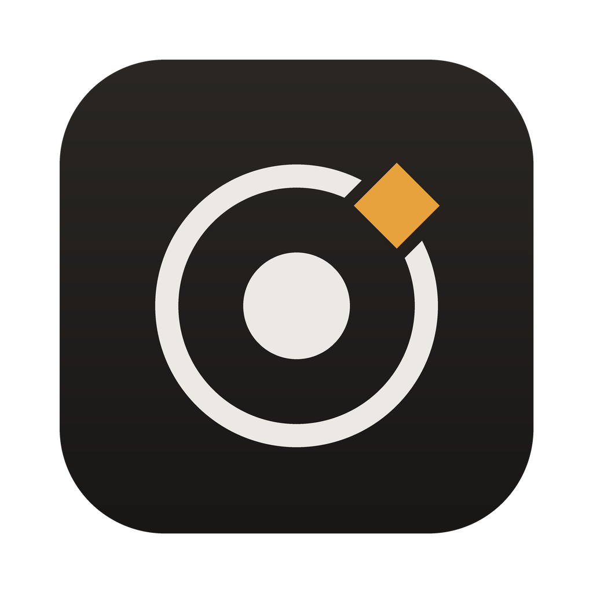
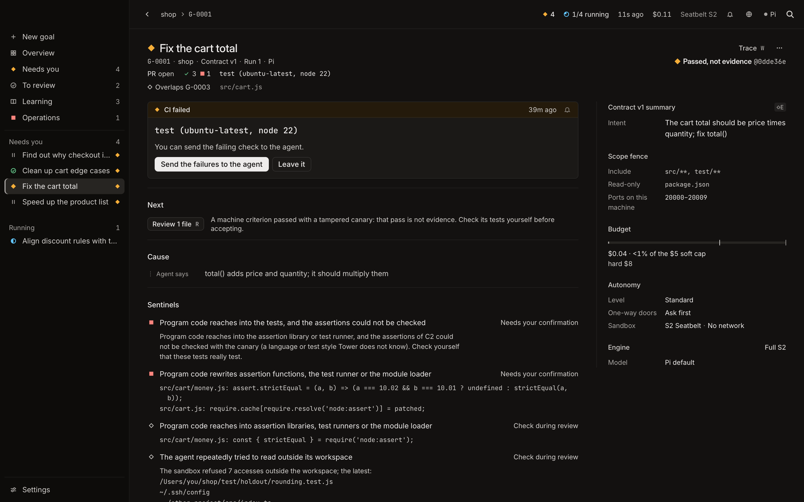
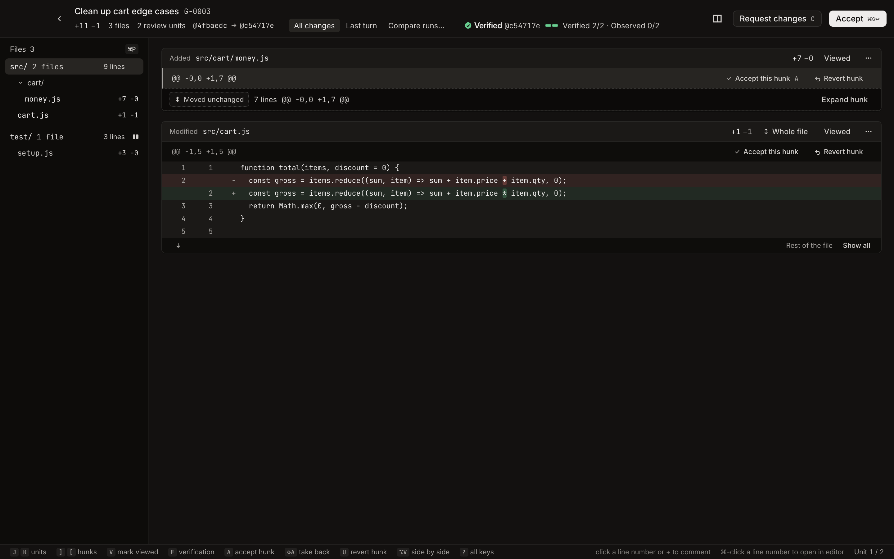
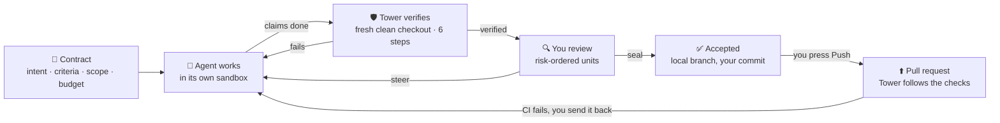

<div align="center">



# Tower

### The control tower for your coding agents.

Run several agents at once, each in its own sandbox.<br>
Tower checks their work itself, in a clean checkout, before you ever see a green light.

[](https://github.com/beautifulrem/tower/actions/workflows/ci.yml)
[](LICENSE)
[](#-quick-start)
[](https://tauri.app)
[](crates/)
[](apps/desktop/)

[**Quick start**](#-quick-start) · [**Features**](#-features) · [**How it works**](#-how-it-works) · [**Security**](#-security) · [**Docs**](#-documentation) · [**简体中文**](README.zh-CN.md)

</div>

<br>

<picture>
  <source media="(prefers-color-scheme: light)" srcset="assets/screenshots/overview-light.png">
  
</picture>

<br>

## 🧭 Why Tower?

Most agent tools hand you a chat transcript. That works for one agent and one short task. It stops working when three agents run for an afternoon. A scrolling log looks like progress. And *"all tests pass"* in a message looks exactly like a real test run.

Tower is built around four questions instead: **what was the agent asked to do, what is it doing now, what has actually been proven, and what changed?**

| | Chat-style agent tools | **Tower** |
|---|---|---|
| Unit of work | A session | **A goal**, with a contract and acceptance criteria |
| "Done" means | The agent says so | **Tower re-runs your criteria** in a fresh, credential-free checkout |
| Agent's own words | Shown like everything else | **Labelled "Agent says"**, and never shown in green |
| Many agents at once | Many tabs | **One board**, with what needs you on top |
| Agent's reach | Often your whole account | **A per-goal, deny-by-default kernel sandbox** |
| Where changes land | Straight in your working copy | **In a separate clone**. You seal them into a local branch, and nothing is pushed until you press Push |

## ✨ Features

### 🛡️ Verification that doesn't take the agent's word for it

When an agent claims it is done, Tower pins a snapshot and checks it on its own in a fresh checkout, with no credentials. It runs six steps:

1. **Base run.** A criterion that already passes on the base commit can't prove anything.
2. **Visible criteria.** These run under the goal's sandbox, offline unless the contract allows network.
3. **Held-out tests.** The agent never sees them, and Tower confirms that each file actually ran.
4. **Source-only re-run.** Every non-source edit is reverted (tests, fixtures, config, scripts), and the criteria run again.
5. **Tamper checks.** A must-fail canary and changed expected values catch a test harness that always passes.
6. **Perturbation and flaky checks.** Changed inputs catch some hard-coded answers, and one re-run tells a flaky test from a real failure.

For UI work, `look` criteria take before/after screenshots at desktop and phone sizes, with the page's console errors attached.

<table>
<tr>
<td width="50%"></td>
<td width="50%"></td>
</tr>
<tr>
<td align="center"><b>Goal page</b>: one verdict, with the snapshot it was measured at</td>
<td align="center"><b>Quick peek</b> (<code>Space</code>): check any goal without leaving the board</td>
</tr>
</table>

A pass that the checks above caught reads **Passed, doesn't count**, in amber, with the sentinel that explains why. Green appears only for a verifier pass on the current snapshot.

### 🔔 One place for what needs you

<picture>
  <source media="(prefers-color-scheme: light)" srcset="assets/screenshots/inbox-light.png">
  
</picture>

Agents don't interrupt you with chat. Whatever needs a decision becomes one card in **Needs you** (`⌘2`), and amber is used for nothing else.

- **Approvals show the command as code,** every row in full, so you approve what will actually run.
- **Held-out failures are for you only.** You can send a hint in your own words, name the failing tests, or show the agent the output and give the tests up.
- **Answer from the keyboard** with `1`–`9`, or put a card off with the bell. Words you typed and did not send stay with their card.
- **Every card says what happened and offers a way out:** a run that has stalled, a failed CI check, criteria that can't run in the sandbox.

### 🧱 A kernel sandbox for every goal

On macOS each goal runs under its own Seatbelt profile, which denies by default:

- **Your secrets stay out of reach.** That covers your home folder, other projects, `~/.ssh`, `~/.aws`, `~/.config/gh` and every `*_API_KEY` variable.
- **Writes stay in the goal's own workspace,** plus a copy-on-write package cache, so your own caches can't be poisoned.
- **The agent can't rewrite its own instructions.** `AGENTS*.md`, `CLAUDE*.md`, `.pi/` and `.agents/` are read-only at any depth, and so are hard links.
- **Network is off** unless the contract turns it on. Each goal gets its own 10 loopback ports. Other Unix sockets stay closed, including `docker.sock` and ssh-agent.
- **Clean teardown.** When a run ends, every process the kernel places in that sandbox is stopped, and none of yours.

### 🔌 Bring your own engine

| Engine | Connection | Trust tier | What the agent can touch |
|---|---|---|---|
| **[Pi](https://github.com/earendil-works/pi)** (default) | Native JSONL RPC | Full | 7 fixed tools: `read` `bash` `edit` `write` `ask_user` `log` `submit` |
| **Claude Code** | ACP | Full | Only Tower's sandboxed MCP tools. Built-in tools, hooks and other MCPs are removed. |
| **Codex CLI · Gemini CLI · OpenCode** | ACP | Restricted | A request for any tool outside Tower's is refused and logged |
| **Any ACP adapter** | ACP | Experimental | Labeled as experimental everywhere |

Every `bash` command goes through a real POSIX shell parser first. Commands that can't be undone stop and wait for you. An agent that is truly stuck can say so with `submit(outcome: "blocked")`, without having to fake a pass.

### 🔍 Review built for evidence



- **Risk first.** Changes come in units of up to 300 lines, riskiest first. Moved code and formatting-only changes are folded away.
- **A snapshot timeline.** Compare everything, the changes since your last review, the last turn, or any two runs.
- **Steer in place.** Line comments go back to the agent as one message (`⌘↩`). You can also mark a hunk read (`A`) or revert it.
- **The acceptance seal** (`⌘⇧↩`). It checks that the snapshot is fresh, there are no high-severity sentinels, your own checks are done, and the merge is predicted clean. Then it writes one commit, authored by you, to a local `tower/<goal>-<slug>` branch.
- **Push when you decide.** Push sends that branch to `origin` and can open a pull request. Tower then follows the checks, and a failed CI run comes back as a card you can hand to the agent.

### 🗂️ And the rest of the deck

<table>
<tr>
<td width="50%"></td>
<td width="50%"></td>
</tr>
<tr>
<td><b>Learning</b> (<code>⌘3</code>)
<ul>
<li>Rules mined from your review comments and from failed checks, each approved by you before use.</li>
<li>Per-model stats: first-pass rate, rework rounds, cost per accepted goal.</li>
</ul></td>
<td><b>Operations</b> (<code>⌘4</code>)
<ul>
<li>Scheduled goals (cron, in UTC).</li>
<li>A merge queue with conflict prediction, and <code>depends_on</code> between goals.</li>
<li>Disk use per goal, with safe cleanup.</li>
</ul></td>
</tr>
</table>

- ⌨️ **Keyboard first.** `⌘K` opens the palette, `⌘1`–`⌘4` the four surfaces, `J`/`K` move, `Space` peeks, `R` reviews, and `?` lists every key.
- 📱 **Away from the desk** (both off by default):
  - A phone page over Tailscale, paired by token. It answers Needs-you cards and pauses goals. Decisions that widen what an agent may do stay at the desk.
  - [ntfy](https://ntfy.sh) pushes that carry only a goal's ID, title and kind of item.
- 🎞️ **The full record** (`W`): a time-indexed trace of every step, including every message Tower sent the agent. What Tower did on its own is named and marked as Tower's, and your answers stay yours.
- 🌐 **English and 简体中文** for the interface, menus, notifications, and the agent itself.

## 🔄 How it works



On screen, every statement names its source in a column to its left, so the four kinds never blur:

| Kind | Shown as | Source | Green allowed? |
|---|---|---|---|
| **Fact** | Measured by Tower | Tower ran it and read the result | ✅ Only for a fresh, untampered verifier pass |
| **Observation** | Observation | Seen inside the agent's sandbox | — |
| **Claim** | Agent says | Written by the agent | — |
| **Human** | You | Your contracts, approvals and seals | — |

Status reads by shape before colour. A ring is a goal, and it turns slowly while the goal's work is moving. The `!` disc means it needs you, the `×` disc means danger, and an outlined `i` marks something worth a look that asks nothing. Each colour has one meaning: amber for a decision that is yours, green for verifier proof, red for danger, blue for running. Everything else is grey, and nothing moves under reduced motion.

## 🚀 Quick start

> [!NOTE]
> There is no signed release yet, so Tower is built from source. It takes about five minutes on a recent Mac.

**1. Build and run.** You need macOS 13+, Rust (pinned in [`rust-toolchain.toml`](rust-toolchain.toml)), Node 22+, `pnpm` and `git`.

```sh
git clone https://github.com/beautifulrem/tower.git
cd tower
pnpm install
pnpm dev
```

**2. Try the demo, with no API key.** On the Welcome screen, choose **Try a demo goal**. A scripted engine walks through a full goal: a question, a claim, verification, sentinels and review.

**3. Connect a real engine.** Install Pi, or pick Claude Code, Codex CLI, Gemini CLI or OpenCode in Settings.

```sh
npm i -g @earendil-works/pi-coding-agent
pi            # then /login
```

`pnpm build` puts a `.app` and `.dmg` in `target/release/bundle`. Tagged releases build universal installers and update the Homebrew cask. See [`RELEASING.md`](RELEASING.md).

## 🔐 Security

[`SECURITY.md`](SECURITY.md) holds the threat model and **118 security tests**, which CI runs on every push against the real `sandbox-exec` and real git. It also lists the known limits. Please report vulnerabilities privately, as it describes.

**Being honest about where it stops:**

- The verification steps raise the cost of cheating. They don't rule it out. The real-model anti-cheat regression doesn't pass yet, and [`docs/17-implementation.md`](docs/17-implementation.md) §17.7 lists what it still misses.
- Only macOS Seatbelt sandboxes a goal today. A Linux backend (`bubblewrap`, Landlock, cgroups v2) and an Apple Containerization MicroVM backend (macOS 26+, Apple Silicon) are written and unit-tested, but no run uses them yet. On Linux and Windows the agent's commands are fenced by path only, and Tower's environment check says so.

## 🏗️ Architecture

```text
apps/desktop/            Tauri 2 shell + SolidJS interface
crates/
  tower-core/            Domain model: lifecycle, contracts, provenance, sentinels
  tower-ast/             Tree-sitter analysis (Rust, JS/TS, Python, Bash)
  tower-store/           SQLite WAL event log: one writer, a pool of readers
  tower-pi/              Pi JSONL RPC adapter
  tower-git/             Satellite clones, snapshots, sealing, merge queue
  tower-verify/          Criterion runner: process groups, timeouts, redacted output
  tower-supervisor/      The single writer: lifecycle, verification, sandboxes, schedules, the phone page
extensions/tower-goal/   Pi and ACP bridge: tool policy, shell parser, sandboxed file access
tools/                   Demo engine, CI gates, end-to-end and adversarial runners
```

The supervisor owns all state, and the interface holds a read-only copy. It is light: start-up JavaScript is about 55 KB gzipped, and most views load the first time you open them. CI holds three budgets with [`tools/bundle-budget.sh`](tools/bundle-budget.sh): start-up 64 KB, the goal page 12 KB, and all interface JavaScript 160 KB (about 160 KB today, so new code has to make room for itself).

<details>
<summary><b>Development commands and environment variables</b></summary>

```sh
pnpm check                      # type check, unit tests, clippy, cargo test, extension tests
tools/pre-push.sh </dev/null    # the full local gate (CONTRIBUTING.md shows how to make it a hook)
tools/e2e.sh                    # the interface in WebKit, against views dumped from a real supervisor
tools/adversarial.sh            # optional: anti-cheat regression with a real model

# A demo workspace, kept apart from ~/.tower
tools/demo-engine/make_demo_repo.sh /tmp/tower-demo/shop
TOWER_HOME=/tmp/tower-demo/home cargo run -p tower-supervisor --example seed_demo -- /tmp/tower-demo/shop
TOWER_HOME=/tmp/tower-demo/home pnpm dev

# One goal without the interface, against a real Pi engine
TOWER_HOME=/tmp/tower-live cargo run -p tower-supervisor --example run_goal -- \
  <repo> "<intent>" "<acceptance command>" [provider/model] [extension…]
```

| Variable | Effect |
|---|---|
| `TOWER_HOME` | The data folder. The default is `~/.tower`, and an empty value also means the default. A relative path is refused. |
| `TOWER_OPEN` | A view to open at launch: `goal/G-0001`, `review/G-0001`, `inbox`, … |
| `TOWER_LANG` | The supervisor's language until Settings picks one: `zh…` for Chinese, anything else for English. |
| `TOWER_FLAKY_RERUN` | `1`/`true`/`on`/`yes` or `0`/`false`/`off`/`no` overrides the Settings choice to re-run a failing test once. |
| `TOWER_ACP_COMMAND_<ENGINE>` | The command that starts an ACP engine, for example `TOWER_ACP_COMMAND_CODEX`. |
| `TOWER_CDP_DEBUG` | Set it to log the screenshot browser's DevTools traffic. |

Tower sets every other `TOWER_*` name itself. If your models come from a Pi extension package, add it under **Settings → Extra Pi extensions to load**. Tower passes `*_API_KEY` to Pi, never to the agent's shell.

</details>

## 📚 Documentation

| Start here | What it covers |
|---|---|
| [`docs/17-implementation.md`](docs/17-implementation.md) | How the code maps to the spec, and where it differs |
| [`docs/07-verification-and-honesty.md`](docs/07-verification-and-honesty.md) | Verification in depth |
| [`apps/desktop/PRODUCT.md`](apps/desktop/PRODUCT.md) · [`apps/desktop/DESIGN.md`](apps/desktop/DESIGN.md) | Who the interface is for, and its rules: colour, type, marks, motion (English) |
| [`docs/19-anti-chat-console-design.md`](docs/19-anti-chat-console-design.md) · [`docs/12-visual-design-system.md`](docs/12-visual-design-system.md) | The interface design in long form |
| [`ROADMAP.md`](ROADMAP.md) · [`CHANGELOG.md`](CHANGELOG.md) | What shipped and what's next |

The full design specification lives in [`docs/`](docs/), written in Chinese, with 240 decision records in [`docs/15-decision-log.md`](docs/15-decision-log.md). You don't need it to start.

## 🤝 Contributing

Issues and pull requests are welcome. See [`CONTRIBUTING.md`](CONTRIBUTING.md) for setup and the checks every change has to pass, and [`CODE_OF_CONDUCT.md`](CODE_OF_CONDUCT.md).

If Tower is useful to you, a ⭐ helps others find it.

## 📄 License

[GNU Affero General Public License v3.0](LICENSE)
