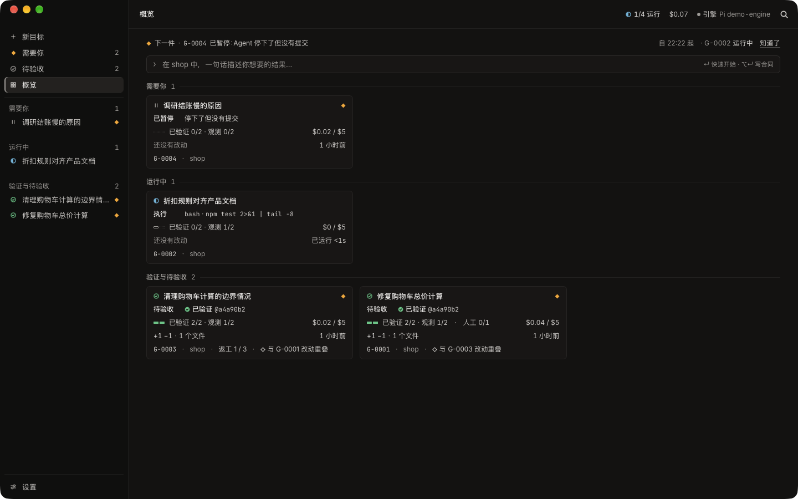
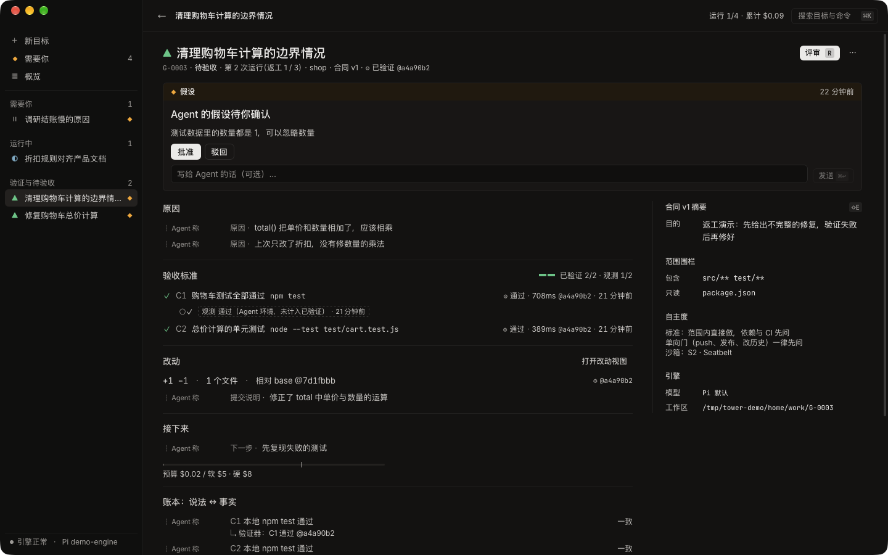
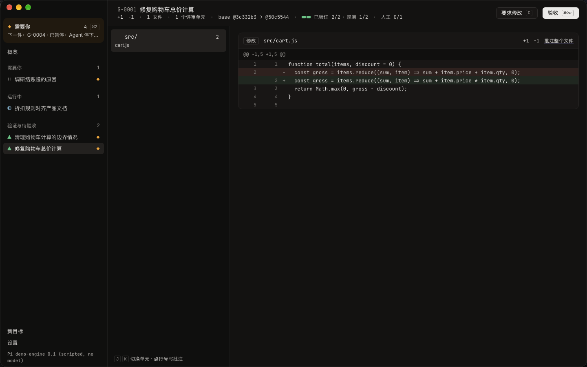
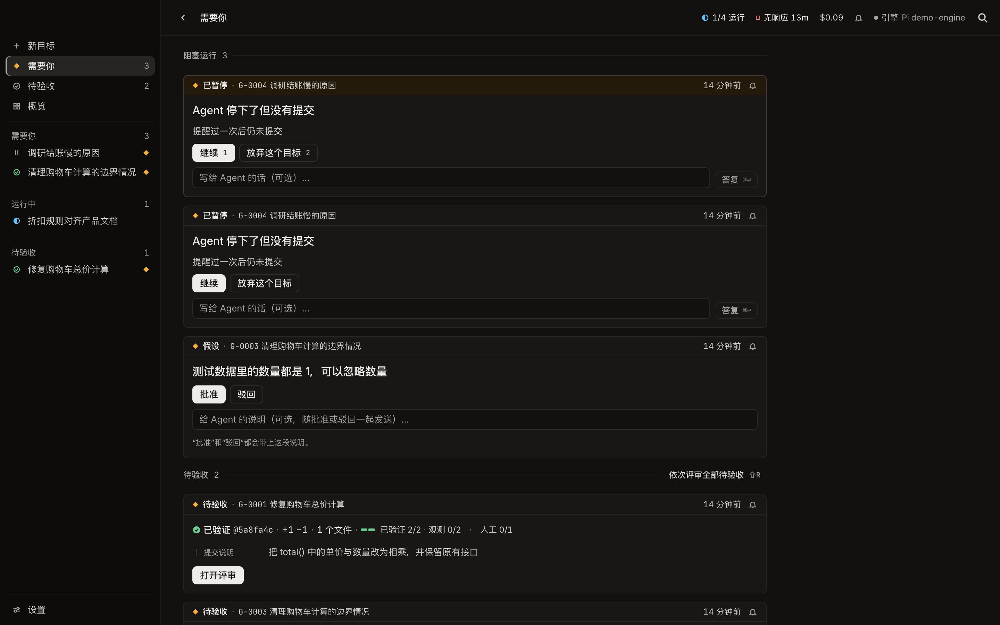
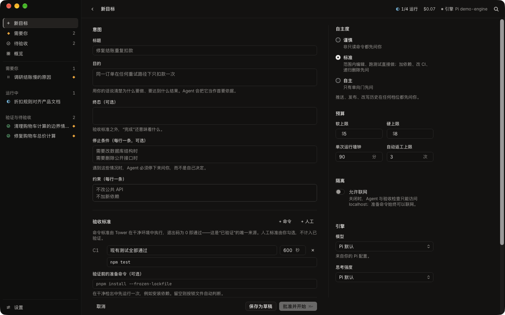

# Tower

English · [简体中文](README.zh-CN.md)

**A goal-centric supervision desk for coding agents. Engine: [Pi](https://github.com/earendil-works/pi).**

Most agent GUIs inherit the editor layout: sessions on the left, a chat stream in the middle, a diff on the right. Tower asks what you actually need to see when you hand work to an agent: what it is going to do, what it is doing, what it got done, what it changed — and the evidence.



## Why Tower

- **Goals, not sessions.** The sidebar holds goals and a Needs-You inbox. Sessions are traces inside a goal.
- **A goal is a contract.** Intent, executable acceptance criteria, a scope fence, a budget, an autonomy preset and stop conditions.
- **Facts are not claims.** An agent saying "done" is a claim. Tower snapshots the workspace, checks out exactly that snapshot in a clean directory and re-runs your criteria under a sandbox. Only those results are green. What the agent says is labelled "Agent 称" and is never green.
- **Sentinels for passing-but-wrong work.** Deleted tests, `.skip`/`.only`, a rewritten test command, fewer assertions or writes outside the scope hold the goal until you look, even when every criterion passed.
- **Only interrupts you when it must.** Questions, approvals, assumptions, stalls and pauses that need a way out go to Needs-You (with a notification if Tower is in the background). Everything else stays quiet: one live line per goal says what kind of thing it is doing, with a concrete detail.
- **Review is steering.** Large diffs are cut into risk-ordered units of at most ~300 lines; a comment on a line is an instruction to the agent. Viewed marks, draft comments and "since last review" make re-reviews short.
- **Closed by default.** Everything the agent runs — shell and file tools alike — runs under a per-goal macOS sandbox: no credentials, no other projects, no writes outside its workspace, and no network unless the contract allows it. See [SECURITY.md](SECURITY.md).
- **Your repository is untouched.** Each goal works in a private clone. Accepting writes one commit, authored by you, to a new local branch. Pushing and opening a PR are explicit actions of yours.
- **Respects Pi.** Tower adds exactly three tools to the model (`ask_user`, `log`, `submit`) through a standard Pi extension, which also wraps Pi's own four in the sandbox, and every message Tower injects is visible in the trace.

| Goal page | Review |
|---|---|
|  |  |

| Needs-You | Contract editor |
|---|---|
|  |  |

Tower speaks English and Simplified Chinese. A new install follows your macOS language; Settings → Language switches the interface, the menu bar and the language the agent writes to you, at once.

## Install

There is no signed release yet: build from source (below, about five minutes on a recent Mac). When releases appear under [Releases](https://github.com/beautifulrem/tower/releases) (macOS 13+), the first unsigned builds will need right-click → **Open** once.

To see what Tower does before installing Pi, open it and choose **Try a demo goal** on the welcome screen: a small project and a scripted agent run the whole arc — a question, a claim, a clean verification and a review — without any model or credentials (Node.js is needed for the demo's tests).

You also need [Pi](https://github.com/earendil-works/pi) with a model you are logged in to:

```sh
npm i -g @earendil-works/pi-coding-agent
pi            # then /login
```

If your models come from a Pi extension package (for example ClinePass), list its entry file under Settings → "Extra Pi extensions to load" and make its key available in your login shell (`export CLINE_API_KEY=…`). Tower passes `*_API_KEY` variables to Pi but never to the agent's shell.

## Build from source

macOS 13+, Rust (pinned in `rust-toolchain.toml`), Node 22+, pnpm, git.

```sh
pnpm install
pnpm dev        # Tauri dev build with hot reload
pnpm build      # .app / .dmg in target/release/bundle
pnpm check      # type-check, clippy, all tests (what CI runs)
```

### The demo from the command line

`tools/demo-engine` is a scripted stand-in for Pi that speaks its RPC protocol and edits a demo repository like an agent would.

```sh
tools/demo-engine/make_demo_repo.sh /tmp/tower-demo/shop
TOWER_HOME=/tmp/tower-demo/home cargo run -p tower-supervisor --example seed_demo -- /tmp/tower-demo/shop
TOWER_HOME=/tmp/tower-demo/home pnpm dev
```

Or run one goal headlessly against your real Pi:

```sh
TOWER_HOME=/tmp/tower-live cargo run -p tower-supervisor --example run_goal -- \
  <repo> "<intent>" "<acceptance command>" [provider/model] [extension…]
```

## How it is built

```
apps/desktop/            Tauri 2 shell (Rust) + SolidJS interface
crates/
  tower-core/            lifecycle state machine, contracts, honesty grammar, sentinels, review units
  tower-store/           single-writer SQLite event log with projections
  tower-pi/              Pi engine adapter over JSONL RPC
  tower-git/             satellite clones, content-addressed snapshots, sealing, push
  tower-verify/          criterion runner: process groups, timeouts, bounded redacted output
  tower-supervisor/      the single writer that runs goals through their lifecycle
extensions/tower-goal/   Pi extension: ask_user / log / submit, scope and autonomy gate, sandboxed bash
docs/                    the product design (start at 00) and its adversarial reviews
tools/                   demo engine and screenshot helper
```

The supervisor owns all state; the interface holds a read-only replica fed by coalesced updates. The code the window loads at start is about 67 KB gzipped; the review, settings and contract editor load on first use, and syntax highlighting in a worker; CI enforces both budgets (`tools/bundle-budget.sh`). The app is about 11 MB.

## Design

The full design is in [`docs/`](docs/) (in Chinese): vision and principles, research, domain model, lifecycle, interface, Pi integration, architecture, verification, attention, memory, isolation, security, visual system, performance, roadmap, a decision log (ADR-001–240) and a registry. It went through 112 rounds of adversarial review. `docs/17-implementation.md` maps the design to this code and lists what differs.

## Contributing

See [CONTRIBUTING.md](CONTRIBUTING.md). Report vulnerabilities privately as described in [SECURITY.md](SECURITY.md).

## License

[MIT](LICENSE)
