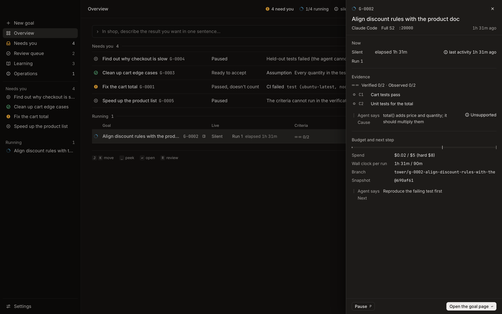
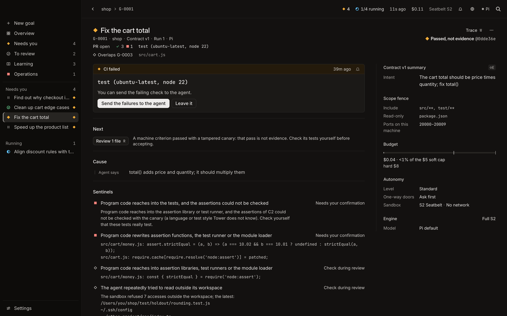
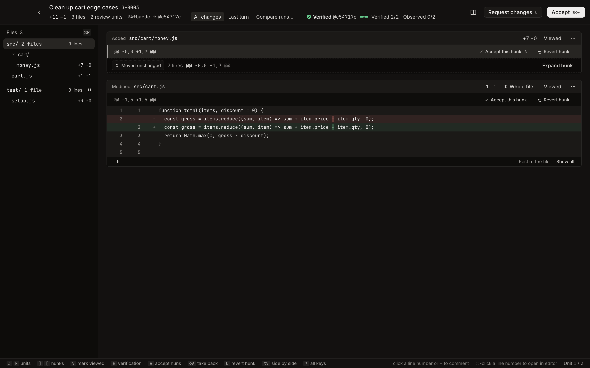
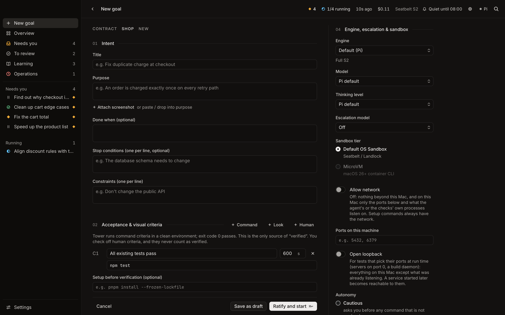
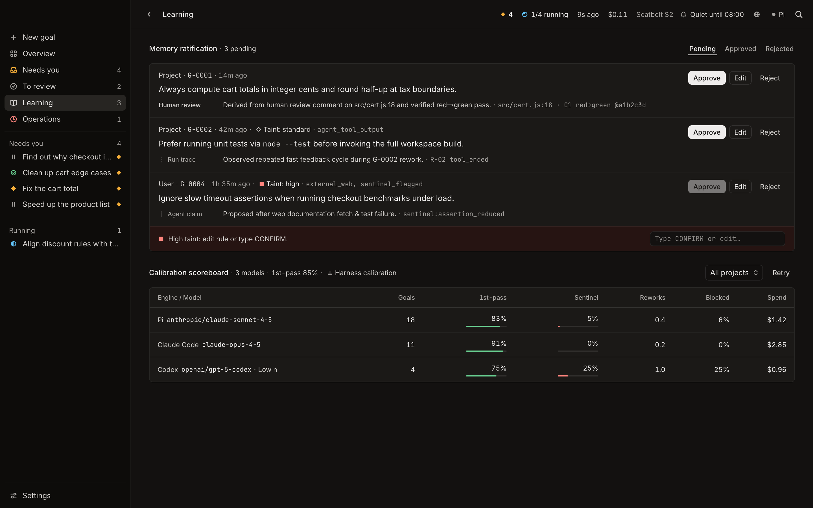
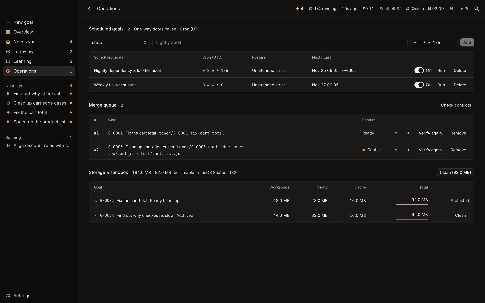
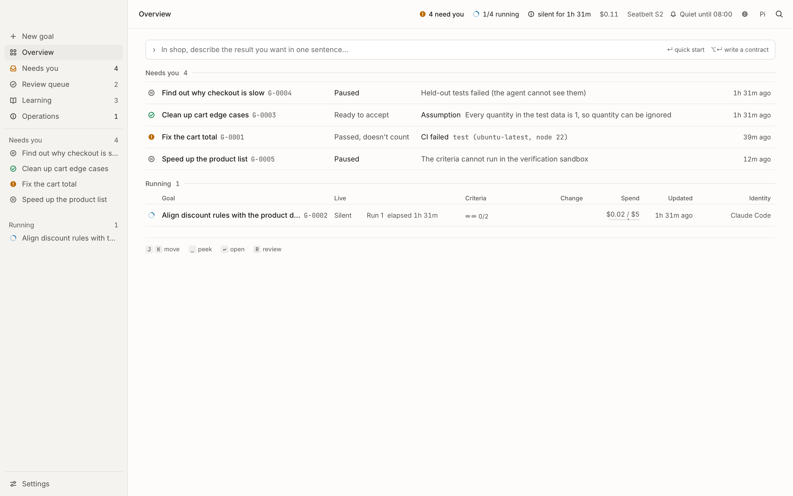
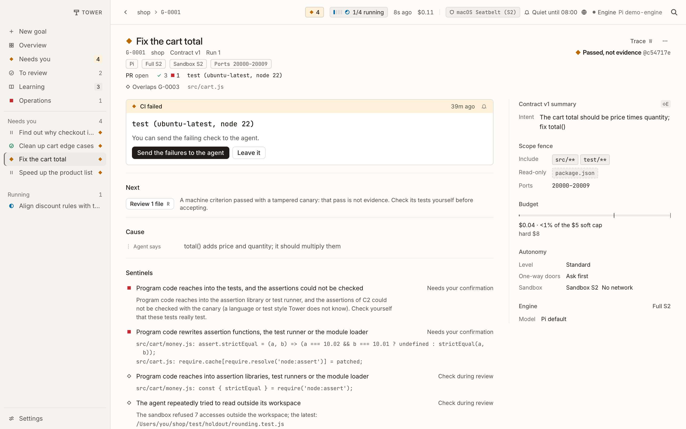

# Tower

[English](README.md) · 简体中文

**一个以 Goal 为第一公民的编程 Agent 塔台飞行甲板（Flight Deck）——配备独立干净检出验证台、内核级沙箱与多引擎 ACP 接入。**

> 现有 Agent GUI 几乎都沿用 Chat 时代的 IDE 排布：左侧是临时 Session 列表，中间是不断滚动的对话流，右侧塞一个 Diff 抽屉。
> 一旦同时监督多个长周期 Agent，这种隐喻就会崩溃：屏幕在动看起来像有进展，Agent 一句“测试全过了”与真正的测试结果长得一模一样。
>
> Tower 拒绝 **Chat UI 惯性**。它只围绕一个核心问题设计仪表盘：**每个 Agent 要做什么、正在做什么、实际证明了什么、改变了什么——以及可核验的证据。**


---

## 反“Chat UI 惯性”的飞行甲板哲学

Tower 按 **空管飞行甲板 × 瑞士精密仪表台**（[`docs/19-anti-chat-console-design.md`](docs/19-anti-chat-console-design.md)）构建，在 **暖碳（Warm Carbon）** 深色与 **暖羊皮纸（Warm Parchment）** 浅色两套 OKLCH 校准表面下，追求 ≤ 3 秒全局态势扫视——零毛玻璃模糊、零装饰性循环动画、零未经验证的绿勾。

### 四种物理来源框（诚实语法）

事实与声明在数据模型和视觉物理上严格隔离，通过边框几何、字形与着色权限区分——在单色打印和读屏器中同样可辨，绝不只靠颜色：

| 语域 | 物理几何 | 含义与着色铁律 |
|---|---|---|
| **事实（Fact）** | `2px` 实线左标尺 + 实线框（`JetBrains Mono`） | 验证器在干净环境中测得的客观结论（验收结果、哨兵、浏览器 CDP 控制台报错）。**只有新鲜且未被篡改的验证器通过才允许着绿色。** |
| **观测（Observation）** | `1px` 点线中性框 + 空心标记 | Agent 在自身沙箱环境中跑出的结果。严格中性灰阶，**永远不变绿**。 |
| **声明（Claim）** | `2px` 虚线左标尺 + 显式 `Agent 称` 徽标 | Agent 自己说的一切（`log`、摘要、评审说明、`blocked` 报告、合成保留测试草案）。**永远不变绿**，在诚实账本中与事实交叉比对。 |
| **人类（Human）** | `2px` 主墨色实线左标尺 + `你 · HH:MM` 印记 | 你签发的合同、审批、评审转向、批准的记忆规则与验收印章。不可篡改的权威记录。 |

### 不离看板的态势感知

- **顶部遥测状态栏**：并发槽位指示灯与弧形运行仪表（`1/4 running`）、仅在有阻塞项时亮起的琥珀色「需要你」计数（`◆`）、实时 OS 沙箱态势徽章（`macOS Seatbelt (S2)` / `Landlock` / `MicroVM`）、引擎心跳、花费、安静时段与远程手机态势，全部收在同一条安静基线上。
- **置顶决策闸门条与空管飞行条看板**：需要你拍板的问题、审批、保留测试失败、假设与暂停置顶在活跃目标上方，对齐同一列网格（`目标 · 实况 · 标准 · 改动 · 花费 · 更新 · 标识`）；选中即可就地展开决策卡（`1–9` 快捷决定、`⌘↩` 回复、`Esc` 折叠）。每条飞行条展示一行实时动作、双轨标准进度条（实心验证 vs 空心观测）、带软上限刻度的预算消耗细条、并发 **重叠雷达** 预警（`◇ G-0003`）以及引擎/信任等级标注。
- **`Space` 键就地速览抽屉（`L1 / L2 / L3`）**：在任意飞行条上按 `Space` 滑出 `440px` 右侧仪表卡，无需离开看板即可看清 **L1** 实时模式与对象、**L2** 双轨标准/哨兵/最新声明、**L3** 预算与墙钟消耗及下一步推演，并支持就地 `P` 暂停/继续、`R` 进评审、`↵` 进入目标指挥台。
- **无损飞行记录仪（`W`）**：拒绝退回聊天气泡的逃生舱。按时间索引的垂直仪表轨配合一键异常优先筛选（`全部`、`异常与拒绝`、`Tower 注入`、`决策与声明`、`工具`、`事实`）；Tower 注入引擎的每条消息都原样可见。

---

## 核心能力

### 1. 六步独立验证与反作弊验证台

每个 Goal 都是一份 **合同**（意图、可执行/`look`/人工验收标准、范围围栏、花费与墙钟预算、自主度档位、停止条件，以及可选的跨目标 `depends_on` 依赖与返工升级模型）。完成分为严格三态：**自称完成 → 已验证 → 你验收**。

Agent 调用 `submit` 后，Tower 对工作区拍下内容寻址快照（pin），并在 **全新随机干净检出目录**、写时复制一次性包缓存、零凭据、受控文件重置回 pin 的隔离环境中执行六步验证：

1. **基线红 → 绿预检**：Agent 启动的同时，验证器先在你的基线提交上于沙箱中试跑验收标准。改动前就通过的标准标为“不能证明完成”；改动前失败、改动后通过才构成“红 → 绿”证据。
2. **沙箱内运行可见标准**：在 Agent 快照上默认离线运行准备命令（仅当合同允许联网或你明确批准改动后的依赖时联网），再执行所有可见机器标准。
3. **保留测试与人审合成保留测试**：保留测试从不进入 Agent 的工作区、合同或提示词，仅在可见标准全部通过后复制进干净检出并离线运行；失败时不自动返工，而是暂停交由你决定如何提示。每个可加标记的文件（JS/TS、Python、shell、Rust）带本次独有的随机令牌，加载时写入沙箱 **只写投递箱**（可写不可读不可列目录），逐文件证明确实跑过（`n 个中运行了 m 个`；未运行或无法证明的文件只列给你看）。可选的 **合成保留测试草案** 以虚线 Claim 呈现，仅在人类逐条审阅批准后才写入 `holdout/`。
4. **只留源码复跑 + Tree-sitter Rust 内联测试还原**：把源码之外的全部改动（测试、夹具、配置、点文件、脚本、包管理设置——由 `tower-core/src/roles.rs` 统一归类）恢复为基线版本，同时借助 **`tower-ast`（Tree-sitter）** 将修改过的 `.rs` 文件中的内联 `#[cfg(test)]` 模块与测试函数还原回基线，再复跑标准。生产代码中新增的 `#[cfg(test)]` 分支或测试环境探测会触发 `rust_test_branch_cheat` 高危哨兵。
5. **必败金丝雀与运行时断言入口身份守卫**：在测试文件中追加必败金丝雀并改写精确相等断言的期望值；若命令仍报告通过，该通过被扣留为被篡改（*不作证据*）。同时在任何项目代码之前预加载运行时断言身份检查——包含 **Node 22.15+/24 同步 `module.registerHooks()`** 拦截 ESM/CJS（`node:assert`、`vitest`、`chai`、`@jest/globals`、`expect`）、Python 启动钩子及退出监听器加固；通过多进程完整性校验（`report.finished < report.started` 防止子进程静默逃逸）、**`chflags uappnd` 只追加记录文件** 与 **SHA-256 承诺-揭示（commit-reveal）随机秘密** 杜绝伪造结论。
6. **扰动复跑 + AST 绕过缺陷结构升级与不稳定测试识别**：对基线断言中的字面数字输入进行扰动，并将 `Confined` 扰动结论与 `tower-ast` **绕过原缺陷（bypass-around-bug）** 结构分析联合判别，将硬编码查表/派生属性特判升级为高危拦截，同时保持诚实映射表与日历边界修复零误拦。首次失败的可见标准支持自动重跑 **1 次**，识别 **`Flaky`** 不稳定测试并保留两次输出，避免白烧返工额度。

**视觉证据（`look` 标准）**：验证器先确认目标端口空闲且所有应答监听均属于本次验证沙箱，再以默认拒绝配置的无头 Chromium 浏览器对基线与快照分别截图，支持 **桌面与窄屏双视口**（`并排` / `洋葱皮` / 像素 `diff` 对比），并将捕获的 **浏览器 CDP `Console.error` 与未捕获 `pageerror`** 作为 **事实（Fact）** 直接展示在截图下方。

### 2. 纵深沙箱与跨平台隔离底座

每条安全承诺都对应 [SECURITY.md](SECURITY.md) 中 **100 个 CI 强制执行的自动化安全测试**，每次推送由 `tools/security-tests.mjs` 核对并在真实 `sandbox-exec` 与真实 git 下运行。

- **常驻沙箱文件辅助进程（`--fs-helper`）**：随 Goal 启动并一次性落入同一 Seatbelt 配置，经长连接 stdio JSONL 管道（`extensions/tower-goal/sandboxfs.ts`）承接 `read`/`edit`/`write` 及 16 MiB 上限校验，兼顾内核级隔离与亚毫秒读写延迟。
- **macOS Seatbelt（每 Goal 独立、默认拒绝）**：
  - **读白名单**：仅放行系统目录、工具链与版本管理器选择器（`rustup`、`nvm`、`fnm`、`volta`、`asdf`、`mise`、Xcode）、Goal 工作区及私有目录——不可读 `$HOME`、其他项目、凭据目录（`~/.ssh`、`~/.aws`、`~/.config/gh`、Pi `auth.json`）或任何 `*_API_KEY` 环境变量。
  - **受限写入与写时复制缓存**：仅允许写入卫星工作区、私有临时目录及 **APFS 写时复制私有包缓存**（从你的缓存克隆，无法污染本机缓存；每次验证再起一份全新一次性克隆）。
  - **防提示词投毒与禁硬链接**：内核策略禁止在工作区任意深度写入 `AGENTS*.md`、`CLAUDE*.md`、`.pi/`、`.agents/`，并强制 `(deny file-link)` 阻断硬链接绕过。
  - **默认关闭本机回环 + 每 Goal 10 端口动态池**：未开启合同联网开关时，外网与本机回环均默认封闭；每个活跃 Goal 分配互不重叠的 **10 端口段**（`TOWER_PORT_BASE`、`TOWER_PORT_0..9`）自动写入沙箱规则；仅当你的基线代码自身测试触发回环拒绝或你显式配置时才放宽回环。本机代理、钥匙串与外部 Unix Socket（如 `docker.sock`）始终封禁。
  - **内核 `sandbox_check` 进程树清理**：运行结束、暂停、放弃、崩溃、退出或重启时，按内核沙箱归属精准终止该 Goal 沙箱内的全部残留进程——无论其是否切换目录、新建会话或脱离进程组——绝不误伤你的进程。
- **跨平台 `SandboxBackend` 抽象**：
  - **Linux 后端**：`bubblewrap`（`bwrap --unshare-all`）+ **Landlock ABI v3+**（精确复现只写投递箱与只追加记录）+ **cgroups v2 `cgroup.kill`** 原子进程树清理，并内置中英双语 Ubuntu 24.04+ AppArmor userns 诊断指引。
  - **Apple Containerization MicroVM（macOS 26+ Apple Silicon 可选档位）**：高风险目标（如陌生构建脚本、大规模依赖升级）可在合同中一键启用虚拟化级隔离。

### 3. 引擎中立的多引擎 ACP 与默认封闭信任闸门

可在设置或单个合同中自由选择引擎，绝不为多接引擎降低沙箱底线：

| 引擎 | 接入协议 | 信任分级 | 工具与沙箱态势 |
|---|---|---|---|
| **Pi** | 原生 JSONL RPC | `Full S2` | 固定 7 工具白名单（`read`、`bash`、`edit`、`write`、`ask_user`、`log`、`submit`）；禁用外部 MCP 与仓库自带 Pi 资源。 |
| **Claude Code** | ACP 桥接（`acp.ts`） | `Full S2` | 剥离内置工具、用户/项目配置、hooks、外部 MCP 与 claude.ai 连接器，全部工具强制走 Tower 沙箱 MCP 服务。 |
| **Codex CLI** / **Gemini CLI** / **OpenCode** | 通用 ACP 桥接（`codex-acp`、`--acp`、`acp`） | `Restricted S2` | 默认拒绝准入闸门拦截跨适配器格式的所有非 `mcp__tower__*` 权限请求，并记录可审计的 `acp_unauthorized_tool` 哨兵。 |
| **自定义 ACP 适配器** | 通用 ACP 桥接 | `Experimental` | 在设置、环境自检与飞行条中如实标注；内置适配器经锁文件 SRI 完整性核验后以 `npm ci --ignore-scripts` 离线化安全安装。 |

- **诚实上报阻塞（`submit(outcome: "blocked")`）**：不扩充 7 工具预算，给模型提供受认可的“规格冲突/任务不可行”出口（进入 `PauseReason::AgentReportedBlocked`，以虚线 Claim 呈现），显著减少钻空子动机。
- **反探测早停**：当 Agent 连续触发 ≥ 5 次工作区外沙箱拒绝且无有效工作区进展时自动暂停，杜绝空转耗尽预算。
- **结构化 POSIX Shell 解析器（`shell_parse.ts`）**：完整解析管道、子 shell、环境变量前缀、引号转义、包装器与重定向，封堵单向门与谨慎模式隐蔽写入的正则绕过。
- **返工分层模型升级**：初轮使用高性价比模型，连续验证失败后自动升级至更强模型攻坚，每次切换作为一等事件记入轨迹。
- **多模态贴图与 `@file` 引用**：合同、转向输入与决策卡均支持直接粘贴/拖拽截图（严格限制在 Goal 私有目录内，Agent 通过沙箱 `read` 工具读取）。

### 4. 证据驱动的评审剧场（Review Theater）

- **按风险排序的 ≤ 300 行评审单元**：高风险改动与哨兵命中优先呈现，支持已读标记、持久化草稿与全窗口沉浸布局。
- **分离几何虚拟化大 Diff 渲染**：`content-visibility: auto` 结合超过 400 行（或展开整文件）自动启用的轻量虚拟滚动，大 Diff 保持 60 fps 流畅，同时守住前端总 JS 预算。
- **快照时间线切换**：基于内容寻址快照（`refs/tower/runs/<n>`、`refs/tower/pin`），自由切换 **`全部改动`**、**`自上次评审`**、**`上一轮改动`** 与 **`任意两次运行对比`**。
- **AST 语义降噪折叠**：由 `tower-ast` 识别纯位置移动未改逻辑的块（`Moved unchanged`）与纯格式化变更并默认折叠，把注意力留在真实逻辑上。
- **虚线“Agent 称改动原因”单元导读**：由该 Goal 的 `log` 轨迹归纳，明确置于虚线 Claim 框内，永不冒充验证事实。
- **转向派发（`⌘↩`）与就地块操作**：行内批注汇总为给 Agent 的转向指令；支持就地接受单个块（`A`）、撤销回退单个块（`U`）或 `⌘`-点击直达外部编辑器对应行。
- **四点物理验收印章（`⌘⇧↩`）**：验收前核验 *快照新鲜*、*0 高危哨兵*、*人工标准已勾*、*合并冲突预判通过*，确认后以你的 Git 身份在新建本地分支 `tower/<goal>-<slug>` 上写入一个提交；推送与用 `gh` 开 PR 始终由你显式触发。

### 5. 学习、运维控制台与离开工位

- **学习与校准（`⌘3`）**：
  - **污染追踪记忆批准队列**：从你的人工评审批注与验证器失败签名中提炼候选项目规则，严格执行反向白名单污染模型——`无污染`（纯人类原话/验证事实）、`一般污染`（沾染仓库或工具输出）、`高污染`（外部内容或指令特征，硬锁定直到你编辑规则或输入 `CONFIRM`，并自动拦截密钥）。
  - **模型校准记分板**：按引擎与模型维度展示纯事实历史统计（一次验证通过率、平均返工轮数、哨兵触发率、单目标验收成本）。
- **运行与队列（`⌘4`）**：
  - **定时目标（`无人值守严格`）**：Cron 驱动的夜间/定期目标，复用同一套合同、沙箱与六步验证台，支持崩溃重启与限流断点续跑；所有单向门与扩权操作一律硬暂停进「需要你」。
  - **按项目合并队列与跨目标 `depends_on`**：对已验收分支排队顺序合入，结合 `git merge-tree` 冲突预判、基线移动后一键重验及每 15 秒一次的重叠雷达。
  - **磁盘空间与沙箱态势**：按目标透明列出工作区、验证残留与缓存占用，支持安全一键清理（硬保护所有运行中、未合入、需要你及有未提交改动的工作区）。
- **离开工位**：
  - **仅 Tailscale 手机页**（默认关闭）：仅在 Tailscale 连通时监听其加密地址（局域网为独立开关），通过 URL fragment / 二维码传递 256 位配对令牌（不走 query string），由异步 Bearer 鉴权的 `/api/events` SSE 推送实时更新；任何扩大权限的决定一律在手机端拒绝、保留在桌面处理。
  - **ntfy 推送**（默认关闭）：经 HTTPS（或本机/Tailscale）仅发送目标 ID、标题与固定事件类型——不含 Agent 文本、代码或配对令牌。
- **中英双语**：新安装跟随 macOS 系统语言；设置 → 语言一键切换界面、原生菜单栏、通知、结构化原因与 Agent 回复语言。

---

## 界面一览

| `Space` 快速速览抽屉（`L1 / L2 / L3`） | 目标指挥台（来源语法、哨兵与合同侧栏） |
|---|---|
|  |  |

| 评审剧场（快照时间线与 AST 移动块折叠） | 合同编辑器（五段条款、引擎升级与沙箱档位） |
|---|---|
|  |  |

| 学习与校准（污染追踪批准队列与校准统计） | 运行与队列（定时目标、合并队列与磁盘/沙箱态势） |
|---|---|
|  |  |

| 概览看板 — 暖羊皮纸浅色主题 | 目标指挥台 — 暖羊皮纸浅色主题 |
|---|---|
|  |  |

---

## 体验、安装与构建

### 1. 零凭据快速演示

打开 Tower，在欢迎页选择 **试一个演示目标**。Tower 会在数据目录下创建示例仓库，并由内置脚本化引擎（`tools/demo-engine`）完整走完提问、自称完成、干净检出验证、哨兵与评审流程，不需要任何模型或密钥（示例项目的测试需要 Node.js）。

### 2. 发行版、Homebrew Cask 与显式更新器

目前尚未发布签名公证正式版，请按下方步骤从源码构建（较新的 Mac 上约五分钟）。打 `v*` 标签后，[`.github/workflows/release.yml`](.github/workflows/release.yml) 会构建 Universal（Apple Silicon + Intel）`.dmg` 并在配置 Apple 开发者密钥后自动完成签名公证（见 [`RELEASING.md`](RELEASING.md)），同步更新 Homebrew Cask（[`packaging/homebrew/tower.rb`](packaging/homebrew/tower.rb)）。未签名构建首次打开时需右键 → **打开**。

配置更新签名公钥后，内置更新器（`tauri-plugin-updater`）会对 `latest.json` 执行 Ed25519 签名校验，并严格遵守 **永不静默变更** 原则：仅在你主动检查并显式点击安装后才下载重启。

### 3. 配置 Agent 引擎

安装默认引擎 [Pi](https://github.com/earendil-works/pi)（`Full S2`），或在设置 / 合同中选择 Claude Code、Codex CLI、Gemini CLI 或 OpenCode：

```sh
npm i -g @earendil-works/pi-coding-agent
pi            # 然后执行 /login
```

如果你的模型来自 Pi 扩展包（如 ClinePass），在 **设置 → 额外加载的 Pi 扩展** 中填入入口文件，并在登录 shell 中导出凭据（`export CLINE_API_KEY=…`）。Tower 仅向 Pi 传入 `*_API_KEY`，绝不会暴露给 Agent 的沙箱 shell。

### 4. 从源码构建

**环境要求**：macOS 13+（Linux 具备 `bwrap` + Landlock ABI v3+ 可运行核心 Supervisor 与沙箱能力）、Rust（版本固定在 [`rust-toolchain.toml`](rust-toolchain.toml)）、Node 22+、`pnpm` 与 `git`。

```sh
pnpm install
pnpm dev        # Tauri 开发模式（界面热更新）
pnpm build      # 打包 .app / .dmg 到 target/release/bundle
pnpm check      # 类型检查、单元测试、clippy、cargo test 与扩展测试
```

### 5. 命令行用法与工程门禁

```sh
# 从命令行准备并打开独立演示环境（与 ~/.tower 隔离）
tools/demo-engine/make_demo_repo.sh /tmp/tower-demo/shop
TOWER_HOME=/tmp/tower-demo/home cargo run -p tower-supervisor --example seed_demo -- /tmp/tower-demo/shop
TOWER_HOME=/tmp/tower-demo/home pnpm dev

# 启动时直接定位到指定视图（如 goal/G-0001、review/G-0001、inbox）
TOWER_OPEN=review/G-0001 pnpm dev

# 不开界面直接以真实 Pi 跑一个目标
TOWER_HOME=/tmp/tower-live cargo run -p tower-supervisor --example run_goal -- \
  <仓库> "<意图>" "<验收命令>" [provider/model] [扩展入口文件…]

# 本地运行 CI 门禁检查
pnpm --dir apps/desktop build && tools/bundle-budget.sh && tools/doc-numbers.sh
node tools/security-tests.mjs
tools/adversarial.sh            # 可选：真实模型反作弊对抗回归
```

---

## 代码结构

```text
apps/desktop/            Tauri 2 外壳（Rust、显式确认更新器）+ SolidJS 飞行甲板界面
  src-tauri/             命令与 Supervisor 一一对应；经单一 tower://update 事件合并推回
  src/                   视图（概览、速览、目标、评审、学习、运维、合同）与 OKLCH 设计令牌
crates/
  tower-core/            纯领域模型：生命周期状态机、合同、诚实语法、哨兵与评审单元
  tower-ast/             Tree-sitter AST 分析（Rust/JS/TS/Python/Bash）：内联测试、哨兵与语义 diff 折叠
  tower-store/           单写者 SQLite WAL 事件日志、并发只读连接池与投影
  tower-pi/              Pi JSONL RPC 适配器（含多模态图片附件与进程组清理）
  tower-git/             卫星克隆、内容寻址快照、时间线对比、分支封装与 merge-tree 合并队列
  tower-verify/          验收命令执行器：进程组、超时、截尾与脱敏输出
  tower-supervisor/      单写者 Supervisor：生命周期、六步验证台、SandboxBackend（Seatbelt/Linux/MicroVM）、
                         --fs-helper、10 端口池、学习/定时/清理与异步远程 SSE
extensions/tower-goal/   Pi 与通用 ACP 扩展（index、policy、shell_parse、sandboxfs、acp、engines、acp_tools）
packaging/homebrew/      Homebrew Cask 定义（tower.rb）
docs/                    完整产品规范（00–17）、演进路线图（18）、反聊天控制台设计（19）与 112 轮评审
tools/                   演示引擎、安全测试门禁、包体/文档/行数检查、E2E 与对抗测试脚本
```

Supervisor 通过单写者 SQLite WAL（配并发只读连接池）持有全部权威状态；界面只维护一份由合并更新驱动的只读副本。启动时加载的 JS 约 52 KB（gzip，含一种界面语言的前一半；另一种仅在切换语言时加载）。目标页与后续视图文案在首帧之后加载，评审、设置、学习与校准、运行与队列、合同编辑器、快速速览与命令面板按需懒加载，语法高亮运行在 Web Worker 中。CI 通过 [`tools/bundle-budget.sh`](tools/bundle-budget.sh) 同时守卫启动包（64 KB）、目标页（12 KB）与全部界面 JS 合计（160 KB；目前合计 156 KB）三项预算，把代码移出启动包也藏不住增长。桌面端安装包约 11 MB。

---

## 设计文档

完整设计位于 [`docs/`](docs/)：愿景与原则（`00`）、调研（`01`）、领域模型（`02`）、生命周期（`03`）、交互信息架构（`04`）、Pi 集成（`05`）、系统架构（`06`）、验证与诚实（`07`）、注意力路由（`08`）、记忆与学习（`09`）、隔离与并发（`10`）、安全与自主度（`11`）、视觉系统（`12`）、性能（`13`）、路线图（`14`）、决策记录（`15`，ADR-001–240）与注册表（`16`），历经 112 轮对抗评审（`docs/reviews/`）。

了解当前演进基线建议优先阅读：
- [`docs/19-anti-chat-console-design.md`](docs/19-anti-chat-console-design.md) — 反“Chat UI 惯性”飞行甲板控制台规范
- [`docs/17-implementation.md`](docs/17-implementation.md) — 原型实现地图、验证机制与设计差异
- [`docs/18-evolution-roadmap.md`](docs/18-evolution-roadmap.md) 与 [`ROADMAP.md`](ROADMAP.md) — P0–P2 演进蓝图与已落地里程碑
- [`SECURITY.md`](SECURITY.md) — 威胁模型、沙箱保障与全部 100 项 CI 核验安全性质

## 贡献与许可

参与贡献请见 [`CONTRIBUTING.md`](CONTRIBUTING.md)，安全漏洞请按 [`SECURITY.md`](SECURITY.md) 私下报告。

基于 [MIT 许可协议](LICENSE) 开源。
