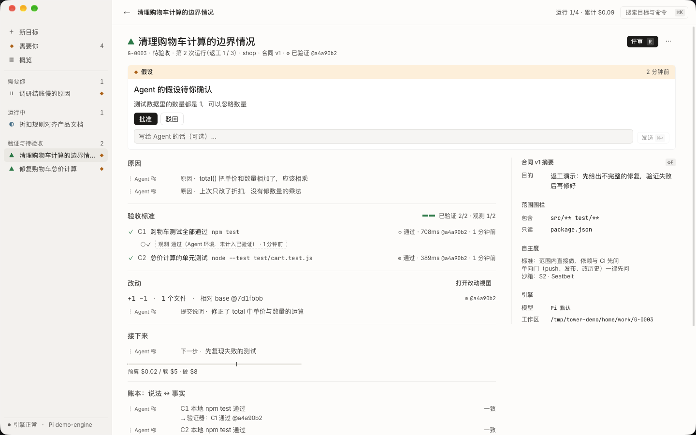

# Tower

[English](README.md) · 简体中文

**一个以 Goal 为第一公民的编程 Agent 监督台。引擎：[Pi](https://github.com/earendil-works/pi)。**

> 现有 Agent GUI 几乎都沿用 VSCode 的排布：左侧 Session 列表，中间是 Agent 输出流，右侧是 Diff。
> 这是 Chat 时代的惯性。Tower 问的是另一个问题：和 Agent 交互时，我们真正想看到的是什么？
> 是它**要做什么、在做什么、做成了什么、改变了什么**——以及**证据**。


## 核心主张

1. **Goal，而不是 Session。** 侧边栏只有 Goal 与「需要你」收件箱；Session 降级为 Goal 里的轨迹。
2. **Goal 是一份合同。** 意图、可执行的验收标准、范围围栏、预算和自主度。
3. **事实与声明分离。** Agent 说“完成”只是声明。Tower 对工作区拍快照，在干净检出里、沙箱中重跑验收标准；只有这些验证器结论能是绿色。Agent 的话以虚线标出、写明“Agent 称”，永远不变绿。
4. **完成三态。** 自称完成 → 已验证 → 你验收。只有你的验收会写入你的仓库，而且只是新建一个本地分支；推送和开 PR 只在你明确操作时发生。
5. **例外管理。** 只有问题、审批、待确认的假设和需要你选择出路的暂停会打扰你；其余时间每个 Goal 只有一行实况，说明它在做哪一类事、对象是什么。
6. **评审即操控。** 大 diff 切成按风险排序、每个不超过约 300 行的评审单元；在某一行写的批注就是给 Agent 的转向指令。
7. **默认封闭。** Agent 运行的一切（shell 命令与读、改、写文件的工具）都在每个 Goal 独立生成的 macOS 沙箱中：读不到凭据和其他项目，写不出工作区，除非合同允许，否则不能联网。见 [SECURITY.md](SECURITY.md)。
8. **Pi 或 Claude Code。** Goal 可以运行在 Pi 上，也可以通过 Agent Client Protocol 运行在 Claude Code 上：Tower 不给 Claude Code 任何内置工具，只提供自己的沙箱版读、改、写、bash 以及 `ask_user`、`log`、`submit`，因此合同、沙箱、验证与哨兵照常生效。在设置中或按目标选择引擎。
9. **尊重 Pi。** Tower 通过一个标准 Pi 扩展只给模型加三个工具（`ask_user`、`log`、`submit`），同时把 Pi 自带的四个工具包进沙箱；Tower 注入的每条消息都在轨迹中原样可见。

| Goal 页 | 评审 |
|---|---|
|  |  |

| 需要你 | 合同编辑器 |
|---|---|
|  |  |

<p align="center"></p>

界面支持简体中文与英文。新安装跟随 macOS 的首选语言；在设置的“语言”中切换后，界面、菜单栏以及 Agent 写给你的语言立即一起改变。

## 状态

设计中 M1 主循环的可运行原型。在 macOS 上以 RPC 模式驱动 Pi，端到端跑通：隔离工作区 → Agent 运行 → 声称完成 → 沙箱中验证 → 自动返工 → 评审 → 写入本地分支 → 识别合入。实现了什么、与设计有何差异、已知缺口见 [`docs/17-implementation.md`](docs/17-implementation.md)。

## 运行

目前还没有签名的发行版，请从源码构建（较新的 Mac 上约五分钟）。需要：macOS 13+、Rust（版本固定在 `rust-toolchain.toml`）、Node 22+、pnpm、git，以及已登录模型的 [Pi](https://github.com/earendil-works/pi)（`npm i -g @earendil-works/pi-coding-agent`，然后运行 `pi` 并 `/login`）。

```sh
pnpm install
pnpm dev            # Tauri 开发模式（界面热更新）
pnpm build          # 打包 .app / .dmg 到 target/release/bundle
pnpm check          # 类型检查、clippy 与全部测试
```

在设置中添加一个 git 仓库，回到概览写一句你想要的结果，按回车。

Tower 默认不加载你的 Pi 扩展（它们在沙箱之外运行）。如果你的模型来自扩展包（例如 ClinePass 的 `pi-clinepass-provider`），在设置的“额外加载的 Pi 扩展”中填入它的入口文件，并让 Tower 能读到它需要的凭据（例如在登录 shell 中 `export CLINE_API_KEY=…`，Tower 会把 `*_API_KEY` 传给 Pi，但不会传给 Agent 的 shell）。

也可以不开界面直接跑一个目标：

```sh
TOWER_HOME=/tmp/tower-live cargo run -p tower-supervisor --example run_goal -- \
  <仓库> "<意图>" "<验收命令>" [provider/model] [扩展入口文件…]
```

### 不需要模型凭据的演示

最快的方式：打开 Tower，在欢迎页选择“试一个演示目标”。Tower 会创建一个小项目，由脚本化的 Agent 走完整个过程（提问、声称完成、干净环境验证、评审），不需要任何模型或凭据（演示项目的测试需要 Node.js）。

也可以从命令行准备演示数据。`tools/demo-engine` 是一个按 Pi 的 RPC 协议应答的脚本化引擎。它不调用模型，但会像 Agent 一样在演示仓库里读代码、跑测试、记录原因、提问、修改并提交。

```sh
tools/demo-engine/make_demo_repo.sh /tmp/tower-demo/shop
TOWER_HOME=/tmp/tower-demo/home cargo run -p tower-supervisor --example seed_demo -- /tmp/tower-demo/shop
TOWER_HOME=/tmp/tower-demo/home pnpm dev
```

`TOWER_HOME` 让演示数据与你真实的 `~/.tower` 分开。

## 结构

```
apps/desktop/            Tauri 2 外壳（Rust）+ SolidJS 界面
  src-tauri/             命令一一对应 Supervisor 方法，更新经一个事件推回
  src/                   视图、组件、设计令牌（docs/12）
crates/
  tower-core/            领域模型：生命周期状态机、合同、诚实语法、评审单元
  tower-store/           单写者 SQLite 事件日志与投影
  tower-pi/              Pi RPC 适配器
  tower-git/             卫星克隆、内容寻址的快照、封装分支
  tower-verify/          验收命令执行器：进程组、超时、截尾与脱敏的输出
  tower-supervisor/      把以上部分串成 Goal 生命周期的单写者
extensions/tower-goal/   Pi 扩展：ask_user / log / submit、范围与自主度门禁、沙箱版 bash
docs/                    产品设计（从 00 开始读）与对抗评审记录
tools/                   演示引擎与截图脚本
```

Supervisor 持有全部状态；界面只保存一份由合并后的更新驱动的只读副本；启动时加载的 JS 约 66 KB（gzip，含一种界面语言），评审、设置、合同编辑器、命令面板按需加载，语法高亮在 Worker 中；三项预算由 CI 检查（`tools/bundle-budget.sh`，启动包 72 KB）。

## 设计文档

[`docs/`](docs/) 包含愿景与原则（`00`）、调研（`01`）、领域模型、生命周期、交互、Pi 集成、系统架构、验证与诚实、注意力、记忆、隔离、安全、视觉、性能、路线图、决策记录（ADR-001–240）、注册表，以及原型实现说明（`17`）。设计经过 112 轮对抗评审（`docs/reviews/`）。

| 先读 | 再读 | 实现前读 |
|---|---|---|
| `docs/00-vision-and-principles.md` | `docs/03-goal-lifecycle.md` | `docs/05-pi-integration.md` |
| `docs/01-research-synthesis.md` | `docs/04-ux-information-architecture.md` | `docs/06-system-architecture.md` |
| `docs/02-domain-model.md` | `docs/07` – `docs/11` | `docs/12` – `docs/17` |

## 许可

MIT，见 [LICENSE](LICENSE)。参与贡献请看 [CONTRIBUTING.md](CONTRIBUTING.md)，安全问题请按 [SECURITY.md](SECURITY.md) 私下报告。
