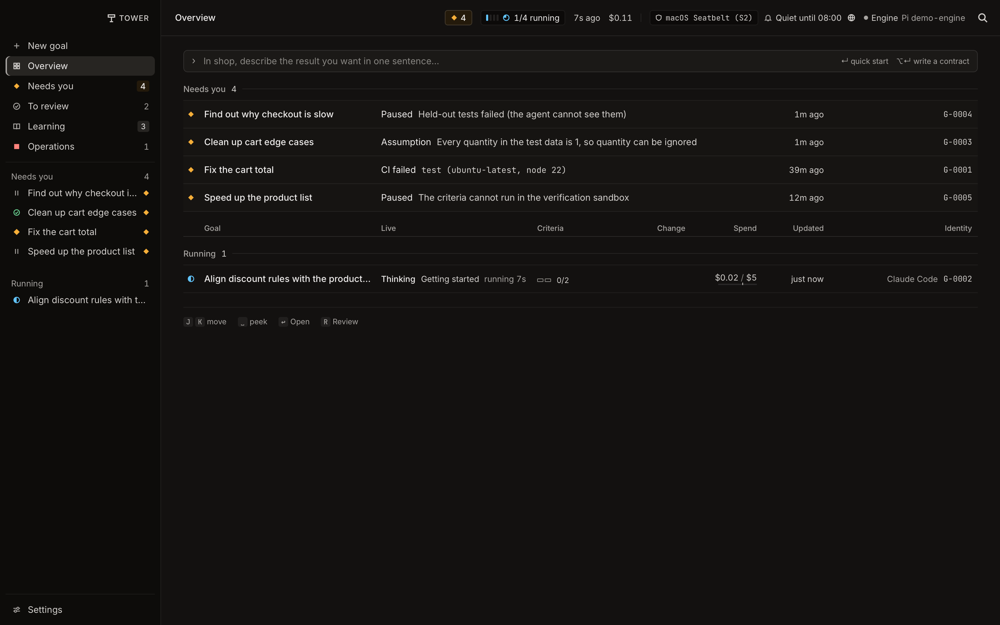
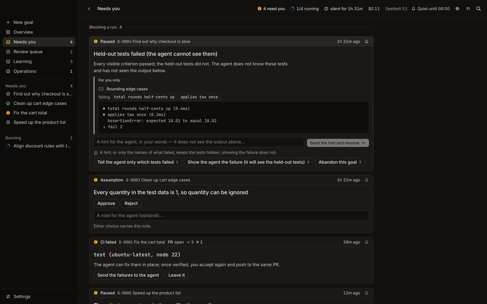
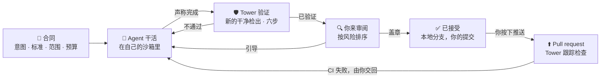

<div align="center">


# Tower

### 编程 Agent 的塔台。

同时让好几个 Agent 干活，每个都关在自己的沙箱里。<br>
在你看到任何一盏绿灯之前，Tower 已经在干净检出里亲自把它们的成果验了一遍。

[](https://github.com/beautifulrem/tower/actions/workflows/ci.yml)
[](LICENSE)
[](#-快速开始)
[](https://tauri.app)
[](crates/)
[](apps/desktop/)

[**快速开始**](#-快速开始) · [**功能**](#-功能) · [**工作方式**](#-工作方式) · [**安全**](#-安全) · [**文档**](#-文档) · [**English**](README.md)

</div>

<br>

<picture>
  <source media="(prefers-color-scheme: light)" srcset="assets/screenshots/overview-light.png">
  
</picture>

<br>

## 🧭 为什么是 Tower？

大多数 Agent 工具给你的是一段聊天记录。一个 Agent 干一件小事，这样没问题；三个 Agent 跑一下午，就不行了。滚个不停的日志看起来像在进展，消息里一句 *“测试全过了”* 和真跑了一遍测试，看起来一模一样。

Tower 换了四个问题来组织一切：**让 Agent 做什么、它现在在做什么、哪些已经真正证明了、改了什么？**

| | 聊天式 Agent 工具 | **Tower** |
|---|---|---|
| 工作单位 | 一个会话 | **一个 Goal**，带合同和验收标准 |
| “做完了”指的是 | Agent 这么说 | **Tower 重跑你的验收标准**，在一份新的、不带凭据的检出里 |
| Agent 自己的话 | 和其他内容一个样 | **标明“Agent 称”**，永远不显示绿色 |
| 同时跑很多个 | 开很多个标签页 | **一块看板**，需要你的排在最上面 |
| Agent 能碰到什么 | 往往是你的整个账户 | **每个 Goal 一个默认拒绝的内核沙箱** |
| 改动落在哪里 | 直接写进你的工作副本 | **在单独的克隆里**；由你盖章写入本地分支，你按下“推送”之前什么都不会推出去 |

## ✨ 功能

### 🛡️ 不听 Agent 一面之词的验证

Agent 声称完成时，Tower 把成果固定成快照，在一份新的、不带凭据的检出里自己检查，分六步：

1. **基线运行**：在基础提交上就已经通过的标准，证明不了任何事。
2. **可见标准**：在 Goal 的沙箱规则下运行；合同不允许联网时，就离线运行。
3. **保留测试**：Agent 从来看不到，Tower 还会核对每个文件确实运行了。
4. **只留源码重跑**：撤销所有非源码改动（测试、fixture、配置、脚本）后再跑一遍。
5. **防篡改检查**：插入一个必须失败的测试并改动期望值，抓出永远通过的测试框架。
6. **扰动与不稳定检查**：改动输入，抓出一部分写死的答案；再跑一次，分清不稳定的测试和真正的失败。

界面类的改动用 `look` 标准：在桌面和手机两种尺寸下截取改动前后的截图，并附上页面的控制台错误。

<table>
<tr>
<td width="50%"></td>
<td width="50%"></td>
</tr>
<tr>
<td align="center"><b>Goal 页</b>：一个结论，带着它所依据的快照</td>
<td align="center"><b>快速查看</b>（<code>Space</code>）：不离开看板就能看任意 Goal</td>
</tr>
</table>

被上面这些检查抓住的通过，显示为琥珀色的 **通过但不作数**，旁边是说明原因的哨兵。绿色只属于验证器在当前快照上的通过。

### 🔔 需要你的事，都在一个地方

<picture>
  <source media="(prefers-color-scheme: light)" srcset="assets/screenshots/inbox-light.png">
  
</picture>

Agent 不会用聊天消息打断你。凡是需要你决定的事，都变成 **需要你**（`⌘2`）里的一张卡片；琥珀色不用在别的任何地方。

- **批准时看到的是命令本身**，以代码显示，每一行都完整，你批准的就是将要执行的。
- **保留测试的失败只给你看**。你可以用自己的话给一个提示，可以只告诉 Agent 哪些测试没过，也可以把输出给它看（这些测试就不再保密）。
- **用键盘回答**：按 `1`–`9` 选择，或者点铃铛稍后再提醒。写了没发出去的字留在它那张卡片上。
- **每张卡片都说清发生了什么、可以怎么办**：一次停滞的运行、一次失败的 CI、在沙箱里跑不了的验收标准。

### 🧱 每个 Goal 一个内核沙箱

在 macOS 上，每个 Goal 跑在自己的 Seatbelt 配置下，默认一律拒绝：

- **你的机密碰不到**：主目录、其他项目、`~/.ssh`、`~/.aws`、`~/.config/gh`，以及所有 `*_API_KEY` 变量。
- **只能写 Goal 自己的工作区**，外加一份写时复制的包缓存，你自己的缓存不会被污染。
- **Agent 改不了自己的指令**：任何深度的 `AGENTS*.md`、`CLAUDE*.md`、`.pi/`、`.agents/` 都是只读的，硬链接也建不了。
- **网络默认关闭**，合同打开才有。每个 Goal 有自己的 10 个回环端口。其他 Unix socket 一直关着，包括 `docker.sock` 和 ssh-agent。
- **收尾干净**：一次运行结束时，内核认定在这个沙箱里的进程全部结束，你自己的进程一个不碰。

### 🔌 引擎随你选

| 引擎 | 连接方式 | 信任档位 | Agent 能用什么 |
|---|---|---|---|
| **[Pi](https://github.com/earendil-works/pi)**（默认） | 原生 JSONL RPC | 完整 | 固定 7 个工具：`read` `bash` `edit` `write` `ask_user` `log` `submit` |
| **Claude Code** | ACP | 完整 | 只有 Tower 在沙箱里提供的 MCP 工具；内置工具、hooks 和其他 MCP 都去掉 |
| **Codex CLI · Gemini CLI · OpenCode** | ACP | 受限 | 申请 Tower 以外的工具一律拒绝并记录 |
| **任意 ACP 适配器** | ACP | 实验 | 出现的地方都标明是实验性的 |

每条 `bash` 命令都先经过真正的 POSIX shell 解析器。无法撤回的命令会停下来等你。Agent 真的卡住时，可以用 `submit(outcome: "blocked")` 直说，不必假装通过。

### 🔍 为证据而设计的审阅


- **风险优先**：改动切成每份最多 300 行，风险高的在前；只挪了位置的代码和只改格式的部分折叠起来。
- **快照时间线**：看全部改动、上次审阅以来的改动、最后一轮，或任意两次运行的对比。
- **就地引导**：行评论合成一条消息发回给 Agent（`⌘↩`），也可以把某一块标为已读（`A`）或撤回。
- **接受盖章**（`⌘⇧↩`）：检查快照是新鲜的、没有高严重度哨兵、你自己的检查都做完了、合并预测没有冲突，然后以你为作者写一个提交，放到本地分支 `tower/<goal>-<slug>`。
- **推送由你决定**：按下“推送”才会把这个分支推到 `origin`，并可以顺手开一个 PR。之后 Tower 跟踪它的检查；CI 失败会变成一张卡片，你可以把它交回给 Agent。

### 🗂️ 甲板上的其他东西

<table>
<tr>
<td width="50%"></td>
<td width="50%"></td>
</tr>
<tr>
<td><b>学习</b>（<code>⌘3</code>）：从你的审阅评论和失败的检查里提炼规则，每条经你批准才生效；还有按模型统计的首次通过率、返工轮数、每个被接受 Goal 的花费。</td>
<td><b>运维</b>（<code>⌘4</code>）：定时 Goal（cron 按 UTC）、带冲突预测的合并队列、Goal 之间的 <code>depends_on</code>、每个 Goal 的磁盘占用及安全清理。</td>
</tr>
</table>

- ⌨️ **键盘优先**：`⌘K` 打开命令面板，`⌘1`–`⌘4` 切换四个主界面，`J`/`K` 移动，`Space` 快速查看，`R` 审阅，`?` 列出全部按键。
- 📱 **离开桌面时**（默认都关闭）：
  - 通过 Tailscale 访问、用 token 配对的手机页面，可以回答“需要你”的卡片、暂停 Goal。会放宽 Agent 权限的决定只能在桌面上做。
  - [ntfy](https://ntfy.sh) 推送只带 Goal 编号、标题和事项类型。
- 🎞️ **完整记录**（`W`）：按时间排列的每一步，包括 Tower 发给 Agent 的每一条消息。Tower 自己做的事写明是 Tower 做的并带它的标记，你的回答始终算你的。
- 🌐 **English 和简体中文**：界面、菜单、通知，连 Agent 本身都跟着切换。

## 🔄 工作方式



屏幕上每条陈述都在左侧一栏写明出处，四类说法不会混在一起：

| 类别 | 界面上写作 | 来源 | 能显示绿色吗？ |
|---|---|---|---|
| **事实** | Tower 测得 | Tower 自己运行并读到的结果 | ✅ 只有新鲜、未被篡改的验证通过才能 |
| **观测** | 观测 | 在 Agent 沙箱里看到的 | — |
| **声称** | Agent 称 | Agent 写的 | — |
| **人** | 你 | 你的合同、批准和盖章 | — |

状态先看形状，再看颜色。圆环代表一个 Goal，它的工作在推进时圆环缓慢转动；`!` 圆盘表示需要你，`×` 圆盘表示危险，线描的 `i` 表示值得看一眼但不要求你做什么。每种颜色只有一个意思：琥珀色是等你决定，绿色是验证器的证明，红色是危险，蓝色是运行中。其余一律是灰色；系统开了“减弱动态效果”时，什么都不动。

## 🚀 快速开始

> [!NOTE]
> 还没有签名的发布版，需要从源码构建；在较新的 Mac 上大约五分钟。

**1. 构建并运行**。需要 macOS 13+、Rust（版本固定在 [`rust-toolchain.toml`](rust-toolchain.toml)）、Node 22+、`pnpm` 和 `git`。

```sh
git clone https://github.com/beautifulrem/tower.git
cd tower
pnpm install
pnpm dev
```

**2. 试试演示，不需要 API key**。在欢迎页选择 **试一个演示目标**，一个脚本化的引擎会走完一个完整的 Goal：提问、声称、验证、哨兵、审阅。

**3. 接入真正的引擎**。安装 Pi，或者在设置里选 Claude Code、Codex CLI、Gemini CLI、OpenCode。

```sh
npm i -g @earendil-works/pi-coding-agent
pi            # 然后 /login
```

`pnpm build` 会在 `target/release/bundle` 里生成 `.app` 和 `.dmg`。打标签发布时会构建通用安装包并更新 Homebrew cask，见 [`RELEASING.md`](RELEASING.md)。

## 🔐 安全

[`SECURITY.md`](SECURITY.md) 里有威胁模型和 **118 个安全测试**，CI 每次推送都会用真实的 `sandbox-exec` 和真实的 git 跑一遍；已知的局限也写在里面。发现漏洞请按其中的说明私下报告。

**它在哪里止步，我们直说：**

- 这些验证提高了作弊的成本，但不能杜绝。真实模型的防作弊回归还没有通过，[`docs/17-implementation.md`](docs/17-implementation.md) §17.7 列出了目前还漏过的类型。
- 目前只有 macOS 的 Seatbelt 真正在给 Goal 做沙箱。Linux 后端（`bubblewrap`、Landlock、cgroups v2）和 Apple Containerization MicroVM 后端（macOS 26+、Apple Silicon）已经写好并有单元测试，但还没有任何一次运行用到它们。在 Linux 和 Windows 上，Agent 的命令只按路径限制，Tower 的环境检查会如实说明。

## 🏗️ 架构

```text
apps/desktop/            Tauri 2 外壳 + SolidJS 界面
crates/
  tower-core/            领域模型：生命周期、合同、出处、哨兵
  tower-ast/             Tree-sitter 分析（Rust、JS/TS、Python、Bash）
  tower-store/           SQLite WAL 事件日志：一个写者、一组读者
  tower-pi/              Pi JSONL RPC 适配器
  tower-git/             卫星克隆、快照、盖章、合并队列
  tower-verify/          标准运行器：进程组、超时、脱敏输出
  tower-supervisor/      唯一的写者：生命周期、验证、沙箱、定时、手机页面
extensions/tower-goal/   Pi 与 ACP 桥：工具策略、shell 解析器、沙箱内的文件访问
tools/                   演示引擎、CI 门禁、端到端与对抗测试的运行脚本
```

所有状态由监督进程持有，界面拿的是只读副本。它很轻：启动时的 JavaScript 约 55 KB（gzip 后），大部分视图在第一次打开时才加载。CI 用 [`tools/bundle-budget.sh`](tools/bundle-budget.sh) 卡住三项预算：启动 64 KB、Goal 页 12 KB、全部界面 JavaScript 160 KB（目前合计 160 KB，新代码得先给自己腾出位置）。

<details>
<summary><b>开发命令与环境变量</b></summary>

```sh
pnpm check                      # 类型检查、单元测试、clippy、cargo test、扩展测试
tools/pre-push.sh </dev/null    # 完整的本地门禁（CONTRIBUTING.md 写了怎么设成 hook）
tools/e2e.sh                    # 在 WebKit 里跑界面，数据是从真实监督进程导出的视图
tools/adversarial.sh            # 可选：用真实模型跑防作弊回归

# 一个演示工作区，与 ~/.tower 分开
tools/demo-engine/make_demo_repo.sh /tmp/tower-demo/shop
TOWER_HOME=/tmp/tower-demo/home cargo run -p tower-supervisor --example seed_demo -- /tmp/tower-demo/shop
TOWER_HOME=/tmp/tower-demo/home pnpm dev

# 不开界面，用真实的 Pi 引擎跑一个 Goal
TOWER_HOME=/tmp/tower-live cargo run -p tower-supervisor --example run_goal -- \
  <repo> "<intent>" "<acceptance command>" [provider/model] [extension…]
```

| 变量 | 作用 |
|---|---|
| `TOWER_HOME` | 数据目录。默认 `~/.tower`，设成空值也是默认；相对路径会被拒绝。 |
| `TOWER_OPEN` | 启动时打开的视图：`goal/G-0001`、`review/G-0001`、`inbox`…… |
| `TOWER_LANG` | 设置里选定语言之前，监督进程用的语言：`zh…` 为中文，其他为英文。 |
| `TOWER_FLAKY_RERUN` | `1`/`true`/`on`/`yes` 或 `0`/`false`/`off`/`no` 覆盖设置里“失败的测试重跑一次”的选项。 |
| `TOWER_ACP_COMMAND_<ENGINE>` | 启动某个 ACP 引擎的命令，例如 `TOWER_ACP_COMMAND_CODEX`。 |
| `TOWER_CDP_DEBUG` | 设上就会记录截图浏览器的 DevTools 通信。 |

其他 `TOWER_*` 变量由 Tower 自己设置。如果你的模型来自某个 Pi 扩展包，把它加到 **设置 → 额外加载的 Pi 扩展**。Tower 会把 `*_API_KEY` 传给 Pi，但绝不传给 Agent 的 shell。

</details>

## 📚 文档

| 从这里读起 | 内容 |
|---|---|
| [`docs/17-implementation.md`](docs/17-implementation.md) | 代码如何对应规格，以及哪里不同 |
| [`docs/07-verification-and-honesty.md`](docs/07-verification-and-honesty.md) | 验证的完整细节 |
| [`apps/desktop/PRODUCT.md`](apps/desktop/PRODUCT.md) · [`apps/desktop/DESIGN.md`](apps/desktop/DESIGN.md) | 界面为谁而做，以及它的规则：颜色、字体、标记、动效（英文） |
| [`docs/19-anti-chat-console-design.md`](docs/19-anti-chat-console-design.md) · [`docs/12-visual-design-system.md`](docs/12-visual-design-system.md) | 界面设计的完整说明 |
| [`ROADMAP.md`](ROADMAP.md) · [`CHANGELOG.md`](CHANGELOG.md) | 已经做了什么、接下来做什么 |

完整的设计规格在 [`docs/`](docs/) 里（中文），其中 [`docs/15-decision-log.md`](docs/15-decision-log.md) 有 240 条决策记录。上手不需要先读它。

## 🤝 参与贡献

欢迎提 issue 和 PR。环境搭建和每个改动要过的检查见 [`CONTRIBUTING.md`](CONTRIBUTING.md)，另见 [`CODE_OF_CONDUCT.md`](CODE_OF_CONDUCT.md)。

如果 Tower 对你有用，点个 ⭐ 能让更多人看到它。

## 📄 许可

[GNU Affero General Public License v3.0](LICENSE)
